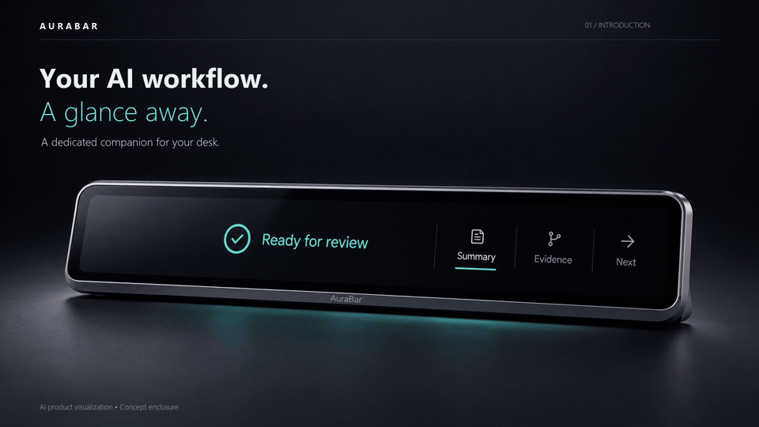

# AuraBar

### Your AI workflow. A glance away.

**An embedded Linux display platform for AI workspaces, focus audio and connected-product development.**

[中文](README.zh-CN.md) · [Product film](docs/product/demo.md) · [Start building](docs/guides/reproduce.md) · [For integration partners](docs/product/integration-brief.md) · [Documentation](docs/README.md)



*Product concept visualization. Explore the working software and real PCB in the [60-second film](assets/demos/AuraBar-Product-Film-1080p.mp4).*

AuraBar brings task progress, review context and focus audio to a dedicated touch display. Keep development and approvals on your computer; use AuraBar to see when work needs your attention. Its T113-S3 hardware, native UI and companion service also provide a documented foundation for embedded product interfaces.

## Built around three useful experiences

| Experience | What it does | Why it matters |
|---|---|---|
| **AI coding companion** | Shows companion-launched Codex task state and Summary / Evidence / Next cards | Turn an agent result into a clear review handoff |
| **Desktop task display** | Follows actual command execution, elapsed time, exit status and connection health | Keep long-running work visible outside the main window |
| **Music & focus** | Plays local WAV/MP3 and synthesized brown noise, rain and ocean textures, with playback controls and a sleep timer | Give the desk a dedicated audio surface |

### From execution to review

Start a task on the computer → follow it on AuraBar → read the result → review and act on the computer.


*Edited replay of actual device captures. The build and AI review are separate recorded tasks. AI/model execution stays on the computer.*

### Make room for focus

Music and tasks share one native device interface. Switch between task cards and audio controls while the backend maintains playback.


*Illustrative waveform with an actual device capture in its recorded paused state.*

## An engineering platform you can inspect and adapt

- **Documented hardware:** T113-S3 dual Cortex-A7, 128 MB in-package DDR3, SPI NAND, MIPI DSI display, touch, audio and USB.
- **Clear system boundaries:** the board handles LVGL, audio and task presentation; the computer handles processes, Codex and model access.
- **An explicit integration contract:** authenticated local companion service, bounded snapshots, USB10 transport, heartbeat and reconnect behavior.
- **Traceable delivery:** editable electronics sources, illustrated circuit analysis, application source, version records, automated checks and board acceptance notes.

[Explore the bilingual hardware design guide →](docs/hardware/README.md)

## Choose your starting point

| You want to… | Start here |
|---|---|
| Evaluate AuraBar for a product or partnership | [Integration brief](docs/product/integration-brief.md) |
| Reproduce the software and hardware workflow | [Reproduction guide](docs/guides/reproduce.md) |
| Run on a compatible, provisioned board | [Quick start](docs/guides/quickstart.md) · [Installation & rollback](docs/guides/installation.md) |
| Compare software generations | [Release catalog](docs/releases/README.md) |
| Build an adapter or change the UI | [Architecture](docs/architecture/README.md) · [Development](docs/development/README.md) |
| Inspect the demonstration and its sources | [Media gallery](docs/product/demo.md) |

**Current software baseline: Coding Companion 0.4.0-alpha.2.** It includes the shared Music & Focus and Desktop Link foundations. Public source supports engineering evaluation on the documented hardware/system baseline. Prepared application binaries remain drafts; a complete blank-board BSP image is not distributed. Check [compatibility and availability](docs/releases/README.md) before assembling or deploying.

## Beyond the desk

| Connected living | Auxiliary vehicle display |
|---|---|
|  |  |

These concepts show where the display platform could fit. Appliance data adapters, vehicle integration and qualification are separate development work. See [capability status](docs/product/status.md) and the [roadmap](docs/product/roadmap.md).

## Engineering resources

```text
hardware/       Editable electronics, schematics, BOM and illustrated design guide
software/       Device application, computer companion and release metadata
docs/           Product, integration, reproduction, architecture and validation
assets/         Product film, GIFs, actual captures and classified visual assets
scripts/        Repository integrity and environment checks
.github/        CI and contribution workflows
```

[](https://github.com/TYF009/AuraBar-T113S3/actions/workflows/repository-checks.yml)
[](https://github.com/TYF009/AuraBar-T113S3/actions/workflows/software-tests.yml)

[Validation](docs/testing/README.md) · [Changelog](CHANGELOG.md) · [Contributing](CONTRIBUTING.md) · [Security](SECURITY.md) · [Licenses](LICENSE) · [Third-party notices](THIRD_PARTY_NOTICES.md)

For a non-confidential integration proposal, [open an issue](https://github.com/TYF009/AuraBar-T113S3/issues/new/choose) with your use case, target system and required interfaces. Commercial support, compliance and delivery commitments must be agreed separately.
