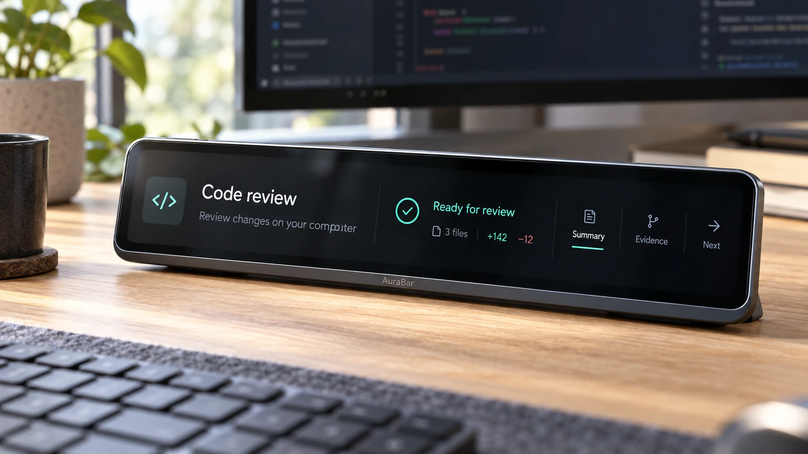
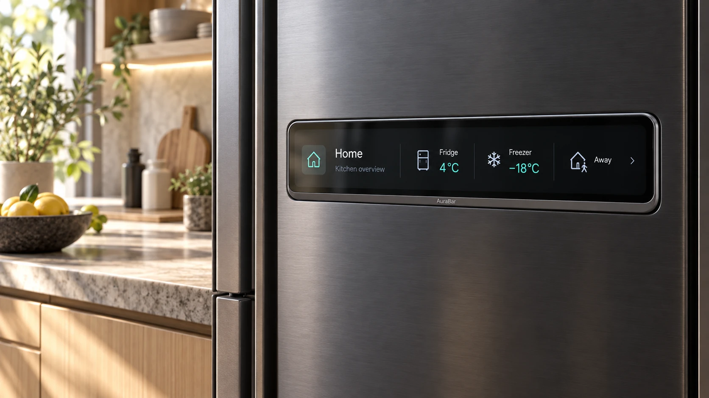
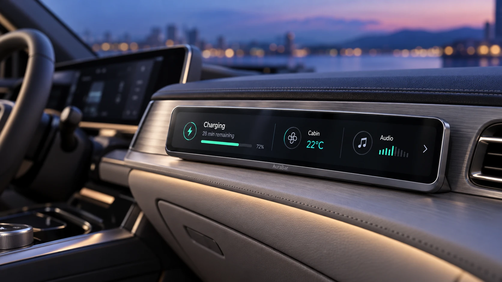
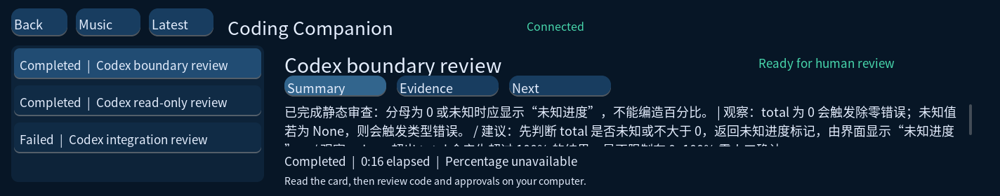

# AuraBar

### 面向智能设备与 AI 工作空间的 Linux 长条交互屏平台

[English](README.md) · [快速开始](docs/guides/quickstart.md) · [选择版本](docs/releases/README.md) · [文档导航](docs/README.md)

*产品概念视觉：外观与界面经过重新设计，实际板卡和运行软件另有验收记录。*

AuraBar 为值得持续关注的信息提供独立的交互入口。T113-S3 Linux 板卡、原生触摸界面、音频服务和电脑伴侣组成共享平台，在桌面上呈现音乐、任务状态和 AI 工作结果。

平台也面向家电、家具和设备的嵌入式界面需求。家居与车内辅助屏展示应用方向，专用数据接入仍需开发，详见[能力状态表](docs/product/status.md)。

## 从工作空间到设备界面

| AI 桌面伴侣 | 音乐与专注 | 智能设备嵌入 |
|---|---|---|
| 查看由电脑伴侣启动的 Codex 任务，阅读摘要、执行证据和下一步建议，在电脑上审阅代码。 | 本地 WAV/MP3、合成环境音、播放控制和睡眠定时，为日常工作提供陪伴。 | 适配家电、家具与信息面板，具体设备接入属于后续工作。 |

| 智能家居概念 | 车内辅助屏概念 |
|---|---|
|  |  |

## 当前可用体验

**Coding Companion 0.4.0-alpha.2** 是当前源码预览版，继承音乐与通用任务同步基础。

- **任务状态可见**：通过 USB10 同步真实进程和 Codex CLI 事件，显示阶段、耗时与结果。
- **结果便于检查**：Summary、Evidence、Next 分别呈现 AI 摘要、观察到的命令退出结果和后续事项。
- **连接状态明确**：心跳过期标记离线，恢复后重新同步，历史完成记录不会反复提示。
- **日常音频可用**：本地 WAV/MP3、棕噪声及合成雨声／海浪质感，提供播放控制和睡眠定时。
- **设备与电脑分工清楚**：板端运行 LVGL 和音频，电脑运行 Codex 并连接其模型服务。

*实机已确认标签切换、长文本滚动、优化后的流畅度及环境音播放／暂停。通知与音乐协调已有自动测试，提示后恢复播放的最终听感仍待确认。*

当前只跟踪电脑伴侣启动的任务。全部桌面聊天同步、屏幕授权与屏幕任务控制尚未提供。真实 AI 验收使用随任务提供的代码完成静态审查；开发电脑上的项目文件执行遇到 Codex 沙箱权限问题，完整项目开发流程尚未验收。[查看完整状态](docs/product/status.md)。

## 选择版本

| 预览版 | 用途 | 验收记录 |
|---|---|---|
| Music & Focus 0.2.0-alpha.1 | 音乐、环境音和基础专注体验 | [查看](docs/software/release-0.2.0-alpha.1.md) |
| Desktop Link 0.3.0-alpha.1 | 通用电脑任务、耗时、结果和断线恢复 | [查看](docs/software/release-0.3.0-alpha.1.md) |
| **Coding Companion 0.4.0-alpha.2** | **Codex 事件与结果卡片，保留共享音频基础** | [查看](docs/software/release-0.4.0-alpha.2.md) |

它们是同一平台的连续迭代，历史构建保留对应源码；当前打包器面向 Coding Companion，尚未实现一条命令构建全部体验配置。

现有包属于**匹配 Tina 基础系统的应用升级包**。完整可刷写 BSP 镜像尚未提供，下载可用性和兼容条件见[发布目录](docs/releases/README.md)。

## 可追溯的硬件设计

主控为全志 T113-S3，片内 128 MB DDR3；W25N01 SPI NAND 提供存储，MIPI DSI、I²C 触摸与 PWM 背光构成交互链路，SoC codec 与 LM4871 提供音频基础。RTL8723DS 提供硬件连接能力，已验证的电脑联动使用 USB10。

蓝牙音频、BLE Mesh 控制和 Wi-Fi 传输验收有独立状态，硬件接线不等于软件功能已启用。[设计总览](docs/hardware/README.md)、[逐模块电路说明](hardware/docs/hardware-design-guide.md)和[接口表](docs/hardware/interfaces.md)说明最终工程与设计取舍。

## 按目标进入文档

| 目标 | 入口 |
|---|---|
| 在匹配板卡上体验 | [快速开始](docs/guides/quickstart.md) |
| 了解安装、资源与恢复 | [安装和回退](docs/guides/installation.md) |
| 排查显示、声音、USB 和 Codex 问题 | [故障排查](docs/guides/troubleshooting.md) |
| 修改与构建软件 | [开发环境](docs/development/README.md) |
| 理解数据流与接口 | [架构](docs/architecture/README.md) · [协议](docs/architecture/task-protocol.md) |
| 评估集成与交付 | [能力状态](docs/product/status.md) · [路线图](docs/product/roadmap.md) |

## 工程组织与验证

`hardware/` 保存硬件源资料；`software/` 保存板端程序与电脑伴侣；`docs/` 提供产品和工程导航；`assets/` 区分概念视觉与实机截图；`scripts/` 和 `.github/` 提供检查入口。

板端继续使用已验证的 `software/app_sdk/` 构建路径。主机回归覆盖存储、队列、倒计时、音乐和任务通信；ARM 构建与实机记录单独列出。[测试说明](docs/testing/README.md)明确自动测试与物理验收边界。

[变更日志](CHANGELOG.md) · [贡献指南](CONTRIBUTING.md) · [安全反馈](SECURITY.md) · [许可](LICENSE) · [第三方与素材来源](THIRD_PARTY_NOTICES.md)
