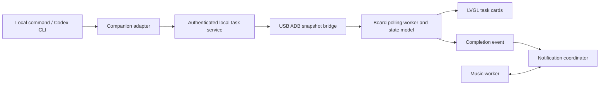

# System architecture

AuraBar separates the device's always-visible interface from the computer's task and model workload.

| Boundary | Responsibility |
|---|---|
| `software/app_sdk/app` | Main-thread UI, navigation and application lifecycle |
| `software/app_sdk/component` | Task model/transport, music, storage, queues and platform-facing services |
| `software/app_sdk/platform` | Display, input, audio and board/host adaptation |
| `software/app_sdk/lvgl` | Vendored LVGL 8.3.1 and supplied adaptation |
| `software/companion` | Local HTTP service, process wrapper, USB bridge and Codex event adapter |
| `software/profiles` | Preview identity and declared feature boundaries |

Networking and decoding workers do not mutate LVGL objects. Snapshots cross into the UI through synchronized state. Music owns its PCM output; notifications coordinate release and resumption. Storage uses bounded records and synchronized temporary-file replacement.

## Design choices

- Native UI/audio and bounded buffers fit the 128 MB platform.
- USB file transport supports the existing ADB daemon without reverse-port support.
- The HTTP task service receives state updates, not arbitrary remote execution requests.
- Schema-1 optional review fields preserve older-reader compatibility.
- Unknown progress remains unknown; process completion and human acceptance remain distinct.
- Source and application upgrades are delivered before a reproducible whole-system BSP image is available.

[Task protocol](task-protocol.md) · [Current product scope](../product/README.md) · [Companion implementation guide](../../software/companion/README.md)
