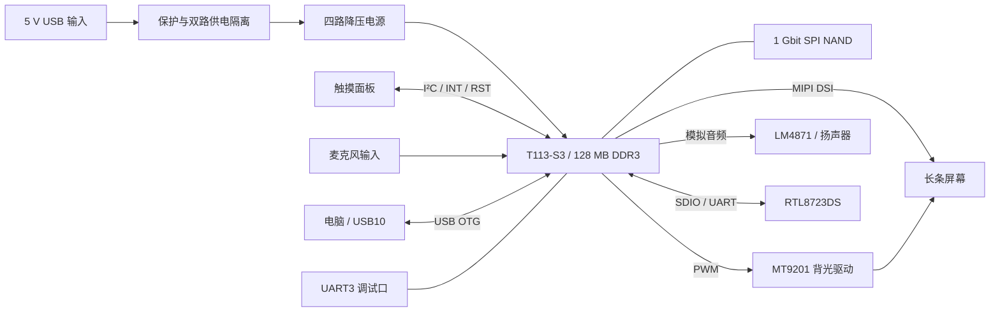

# AuraBar 硬件设计指南

**从产品需求、器件选型到系统调试，理解一块紧凑型 Linux 交互主板如何形成产品。**

AuraBar 面向长条触摸屏终端，将 Linux 主控、显示、触摸、声音、存储和连接接口集成在同一块板卡上。它为桌面 AI 工作伴侣和嵌入式信息屏提供共同的硬件基础：屏幕负责呈现信息，触摸负责轻量交互，音频负责环境音与事件提醒，USB 负责与电脑交换任务状态。

本文基于现有原理图、BOM、网表、原始设计说明及板卡调试记录撰写。器件型号、位号和连线以最终原理图与 BOM 为准；原始说明中的早期备选方案会单独注明。English circuit notes are available in the [bilingual circuit reference](../../hardware/docs/hardware-design-guide.md).

*上图来自提供的 STEP 几何，材质为示意。板体模型约 75 × 38 mm，包含器件的整体包络约 76.42 × 37.97 × 8.41 mm；模型包络不能直接作为装配尺寸或外壳公差依据。*

## 1. 从使用场景确定硬件职责

AuraBar 的硬件设计围绕三个目标展开：让交互界面独立常驻、让声音形成使用闭环、让系统在调试和升级时可以恢复。

| 产品需求 | 硬件设计响应 | 对使用者的价值 |
|---|---|---|
| 常驻显示任务、状态和信息卡片 | T113-S3、片内 DDR3、MIPI DSI 屏幕接口 | 信息可在独立屏幕上呈现，减少对电脑主界面的占用 |
| 通过触摸完成查看和简单操作 | 独立 I²C 触摸接口与中断、复位信号 | 查看任务详情、切换页面和控制播放具有直接入口 |
| 音乐、环境音和完成提示 | SoC codec、LM4871 功放、扬声器接口 | 视觉之外增加可感知的状态反馈 |
| 与电脑或上层服务协作 | USB OTG，以及 RTL8723DS 无线连接电路 | 当前可通过 USB 实现电脑联动，无线方向有硬件基础 |
| 迭代系统与维护设备 | SPI NAND、FEL 入口、复位按键、串口 | 出现启动或应用故障时有分层定位与恢复路径 |

智能家具和车内信息屏可以复用这套显示与交互基础，但设备控制协议、安装结构、供电条件和环境验证需要按场景完成。现有板卡的输入基线为 **5 V USB**；车内使用须通过适合该设备的稳压供电，不能直接接入车辆电源。

## 2. 系统架构与设计优势

图中表示电源和功能关系，不代替原理图中的具体引脚与电源域连接。

### 紧凑的 Linux 交互基础

T113-S3 将双核 Cortex-A7、HiFi4 DSP 与 128 MB DDR3 集成在同一封装内。片内 DDR 减少板上外置内存互连的布线工作，适合尺寸受限的交互设备；LQFP128 封装也便于原型阶段检查、装配和返修。片内 DDR 仍需要正确的供电、去耦和配置，不能省略最小系统设计。

Linux 为文件、音频、设备驱动和电脑通信提供统一的软件基础。128 MB 内存要求界面与服务保持克制，因此当前产品采用板端原生界面、电脑端处理 AI 任务的分工。芯片包含 DSP 资源，但现有软件并未完成 DSP 加速的功能验收，也不以此宣称板端大模型推理能力。

### 显示、触摸、背光分别控制

MIPI DSI 负责像素传输，I²C 负责触摸数据，PWM 负责背光调节。三条链路可以分别排查，也让界面更新与亮度策略拥有各自的控制入口。更换面板时仍须重新核对连接器定义、时序、电气条件和背光需求。

### 音频与电脑联动共同构成交互闭环

屏幕之外，codec 与功放提供音乐和通知的输出链路，麦克风电路提供输入基础。USB10 让电脑任务状态可以进入板端界面，已经支持任务状态、结果卡片和声音提醒等软件迭代。对 AI 工作伴侣而言，价值来自硬件链路与软件事件的配合。

### 将可维护性纳入板卡设计

双 USB 接口、UART3 日志口、复位与 FEL 按键为供电、启动、烧录和应用调试提供了不同入口。配套的可编辑 EDA 工程、原理图、BOM 和网表使设计具备追溯基础，方便集成方从产品描述继续深入到电路核查。

## 3. 最小系统：先让主控可靠启动

T113-S3 的最小系统包含电源、时钟、复位和 DDR 配置。它们共同决定系统能否稳定启动，应当先于屏幕和应用功能完成验证。

| 模块 | 当前设计 | 工程关注点 |
|---|---|---|
| 主时钟 | 24 MHz 晶体，原设计负载电容 12 pF | 负载匹配、布局寄生和起振状态需要结合实际器件核查 |
| 低速时钟 | 32.768 kHz 晶体，跨接 10 MΩ 电阻 | 关注走线、泄漏与干扰，异常时检查 RTC 时钟链路 |
| 复位 | RESET、10 kΩ 上拉、RC、保护与 SW2 | 核查上电复位波形和手动复位是否有效 |
| 片内 DDR3 配置 | 1.5 V 供电，按 T113-S3 对应管脚配置 | 不混用其他 T113 型号的 DDR 电压与配置 |

原始电路图与参数推导见[最小系统电路说明](../../hardware/docs/hardware-design-guide.md#2-minimum-system--最小系统)。原理图中的参数是设计输入；稳定性结论还需要测量与启动测试支持。

## 4. 电源：按电源域组织供电

最终 BOM 使用四颗 **SY8088AAC（U1–U4）**，从 5 V 输入生成四路电源。

| 输出 | 器件 | 设计用途 |
|---|---|---|
| 3.3 V | U1 | 多个 I/O 域与外围电路，具体分支按原理图核对 |
| 1.5 V | U2 | DDR3 相关供电 |
| 0.9 V | U3 | 主控核心相关供电 |
| 1.8 V | U4 | 对应模拟与内部电源域，按原理图分配 |

采用同系列独立降压器件，便于统一器件管理，并分别检查各路电源。代价是需要处理多处开关回路、布局和去耦；电源设计仍需同时考虑器件额定值、负载变化、温升和纹波。原始说明中讨论过 LDO 与其他电源器件，它们不代表当前四路电源的装配配置。

调试时先确认输出电压与对地状态，再观察启动、亮屏、无线活动和音频播放时的波形。当前资料没有给出完整功耗曲线、负载瞬态或温升报告，因此不能据此承诺整机功耗、续航或持续输出能力。

*电源域参考用于解释供电组织；实际连接与器件以最终 POWER 和 T113S3 图页为准。*

## 5. 存储、启动与恢复

系统使用 **W25N01GVZEIG（U6）1 Gbit SPI NAND**，连接至 SPI0。这里的 1 Gbit 等于 128 MiB 的标称原始容量；实际可用空间还受坏块管理、分区、文件系统和系统内容占用影响。它与主控的 128 MB DDR3 是不同用途的两种存储资源。

SPI NAND 保存系统和应用，DDR3 保存运行中的代码与数据。音乐与界面资源需要按实际剩余空间规划；较大的 AI 模型和电脑项目资料适合保留在电脑或服务端。

SW1 通过影响启动阶段的 Flash 识别，为进入 FEL 下载与恢复流程提供硬件入口；SW2 用于复位。具体进入时序应结合现有系统与烧录工具核查。应用升级包与完整系统镜像的恢复方式不同，使用前先阅读[安装与回退](../guides/installation.md)。

## 6. 双 USB-C：区分供电与调试职责

| 接口丝印 | 信号连接 | 当前用途与边界 |
|---|---|---|
| USB10 | USB0 OTG，VBUS 为 VIN5V | 烧录、ADB 与已经验证的电脑伴侣通信，并具有调试供电路径 |
| USB9 | USB1 Host 信号，VBUS 为主 5 V 输入 | 当前作为主供电接口；其他 USB 外设用途须结合供电方向和软件配置验证 |

接口采用 16 针 USB-C 连接器。CC1/CC2 各有 5.1 kΩ 下拉，用于声明取电端连接。**这些电阻不实现 USB PD 协商，当前设计不能据此宣称支持高压快充。** USB1 的 Host 信号连接也不自动意味着 USB9 已具备标准主机端口的 VBUS 输出与角色控制。

D22/D23 肖特基二极管承担两路供电的隔离与防回灌设计，ESD5451N 为相关接口提供保护电路基础。肖特基方案需要考虑压降与发热；保护器件的存在也不等同于整机已通过 ESD 认证。双线连接时应核对实际板卡供电路径，并检查带载电压。

## 7. 屏幕、触摸与背光：分层定位显示问题

### 像素传输

FPC2 为 30 针、0.5 mm 间距屏幕连接器，承载 MIPI DSI 等信号。现有资料对应 6.9 英寸长条屏。屏幕适配需要核对电源、数据通道、复位、时序与驱动初始化，而不能只比较分辨率。

现有基础系统中，面板驱动名为 `fl7707n_mipi`。调试记录里的 framebuffer 为 720 × 1424、32 bpp、行跨度 2880 字节，虚拟高度为 2848；应用当前使用的逻辑可见区域为 1424 × 280。这些数值属于驱动缓冲、方向和界面映射的不同层次，**不能直接把驱动中的 720 改为 280**。定位显示错乱时，应依次核查面板输出、缓冲区布局、旋转裁剪和 LVGL 刷新路径。

### 触摸输入

FPC7 为 6 针、0.5 mm 间距触摸接口，包含 I²C、INT 和 RST 等信号。显示正常而点击偏移时，应单独检查触摸坐标范围、方向转换和应用坐标映射。更换界面或旋转显示后，也要同步验证四角与边缘的触摸位置。

### 背光控制

背光使用 **MT9201（U52）** 升压驱动，EN 接受 PWM 控制，并通过下拉约束启动状态。原设计说明以约 20 mA 为电流设置目标；该值需要结合实际 LED 串并联方式、采样电阻和测量核实。较低电流是亮度、热耗和器件应力之间的取舍，寿命改善仍需测试支持。

背光升压输出高于板卡输入，选用电容时需按输出电压留足额定值余量。亮度异常应分别排查驱动电源、升压输出、PWM 和 LED 回路，避免将黑屏全部归因于软件渲染。

## 8. 音频：把信息转化为可感知的反馈

输出链路为 **SoC codec → 模拟音频 → LM4871（U53）→ CN2 → 8 Ω 扬声器**。最终器件为 LM4871；原始说明中的 LM4890S 属于早期参考。功放与主控集成 codec 配合，为音乐、环境音和任务提示音提供基础，当前软件已有对应实机播放记录。

音频体验还取决于扬声器、安装腔体、供电噪声和软件增益。没有频响、失真和声压测量之前，不宣称高保真音质或指定整机输出功率。功放使能、启动静音和音频设备占用也应纳入软件设计，降低切换时的突发声音和播放冲突。

输入侧使用麦克风偏置、耦合与滤波电路。C46/C47 为 100 nF 耦合电容：在 1 kHz 下，`Xc = 1 / (2πfC) ≈ 1.59 kΩ`，实际低频响应必须结合输入阻抗评估。模拟电源滤波与接地连接用于控制干扰，不构成电气隔离。

麦克风输入是语音方向的硬件基础；唤醒、回声消除、识别和语音助手仍需要音频采集与算法链路验证。

## 9. 无线连接与调试接口

**RTL8723DS（U11）** 的 Wi-Fi 通过 SDC1/SDIO 连接，蓝牙通过 UART1 与流控信号连接。它提供无线适配的电路基础；驱动、固件、天线表现、连接稳定性和应用协议共同决定实际能力。当前已验证的电脑任务链路使用 USB10，Wi-Fi 传输、蓝牙音频和 BLE Mesh 的状态见[能力清单](../product/status.md)。

原理图还包含 UART0 上的 MX-02 预留座。这是可选设计记录，不能视为当前板卡已装配或已提供 Mesh 功能。现阶段产品迭代基于现有板卡开展，重点放在系统和软件能力。

UART3 使用 PB8/PB9，连接至 U24 日志口；LED 使用 PD11，用户按键使用 PD10。接入串口前按原理图核对引脚、电平与地线，不能直接连接 RS-232 电平。完整信号分配见[接口表](interfaces.md)。

## 10. PCB 实现与整机集成关注点

电路能运行只是板卡验证的一部分。集成进外壳、家具或桌面产品后，热、结构、连接与干扰会共同影响体验。

| 区域 | 应检查的设计与装配事项 | 所需证据 |
|---|---|---|
| 电源回路 | 开关电流回路、输入输出去耦、反馈采样、地回流 | PCB 布局检查、纹波与温升测量 |
| MIPI 与 USB | 差分走线、参考平面、连接器过渡、保护器件布置 | 层叠与布线核查、链路稳定性测试 |
| 晶体与复位 | 邻近布置、噪声耦合、复位波形 | 布局核查和示波器记录 |
| 模拟音频 | 与开关节点的距离、供电与回流、功放输出走线 | 噪声、切换瞬态与实际听音记录 |
| 射频与天线 | 天线净空、屏幕金属与外壳影响 | 结构核查与整机无线测试 |
| FPC 与外壳 | 插拔空间、弯折、应力、屏幕固定和散热 | 装配图、实物试装和运行测试 |

这些是设计审查与后续验收项目；现有资料不足以证明全部完成。外观概念渲染可以探索新外壳，正式结构设计则需要使用实际屏幕、板卡、连接器和线缆尺寸。机械资料状态见[机械参考](../../hardware/mechanical/README.md)。

## 11. 建议的板卡验收顺序

1. **断电核查**：确认板卡版本、器件装配、供电极性与连接器方向，检查各电源对地状态。
2. **电源验证**：以受控 5 V 供电检查各路输出、输入电流与异常温升，保留测量记录。
3. **启动与恢复**：检查复位、串口日志、Flash 启动及 FEL 进入方式，记录恢复所需系统和工具版本。
4. **显示与触摸**：先验证固定图案与边界，再检查方向、裁剪、四角点击和滑动；同时验证背光控制。
5. **声音与电脑联动**：以测试音、环境音和真实任务事件检查播放、暂停、提示与连接恢复。
6. **整机运行**：在预期外壳与使用条件下观察持续运行、线缆插拔、温升和无线表现。

每条记录应包含板卡版本、系统镜像、应用版本、连接方式、测试方法和结果。当前显示、触摸、音频与任务界面的实机记录可从[测试说明](../testing/README.md)进入；板级电气验证需要另行形成测量报告。

## 12. 设计资料与阅读路径

| 想了解什么 | 对应资料 |
|---|---|
| 查看或修改电子设计 | [LCEDA Pro 工程](../../hardware/lceda/6.22_Screen.eprj2) |
| 核对具体连接与器件位号 | [原理图 PDF](../../hardware/schematic/AuraBar-Schematic-v1.0.pdf)、[网表](../../hardware/schematic/netlist.net)、[DXF 图页](../../hardware/schematic/dxf/) |
| 核对采购型号与数量 | [BOM Excel](../../hardware/bom/AuraBar-BOM-v1.0.xlsx)、[BOM CSV](../../hardware/bom/AuraBar-BOM-v1.0.csv) |
| 继续阅读逐模块参数与电路图 | [中英双语电路说明](../../hardware/docs/hardware-design-guide.md) |
| 查看最初的设计文字 | [原始 Word 设计说明](../../hardware/docs/hardware-design-guide-source.docx) |
| 接线、适配与整机集成 | [接口表](interfaces.md)、[机械参考](../../hardware/mechanical/README.md) |
| 了解当前可用的软件功能 | [能力状态](../product/status.md)、[软件架构](../architecture/README.md) |

电子设计资料为现有板卡提供追溯基础，当前仓库尚未形成包含完整制造文件、装配基线和全部验证报告的量产交付包。硬件许可见 [CERN-OHL-S-2.0](../../hardware/LICENSE)，第三方材料说明见[来源与许可记录](../../THIRD_PARTY_NOTICES.md)。
