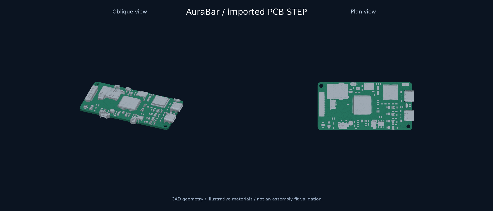
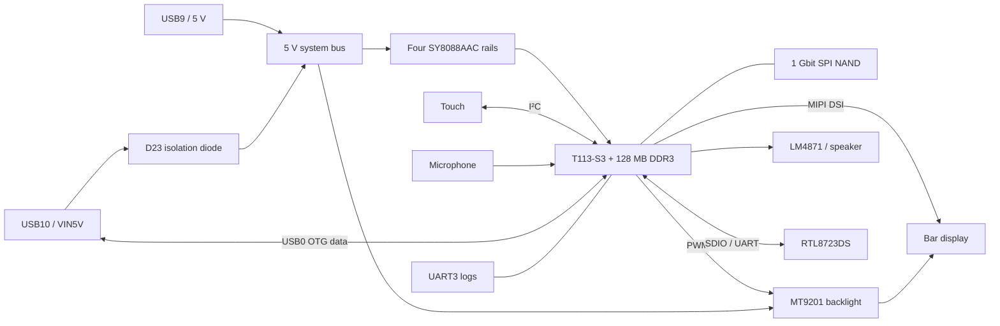

# AuraBar Hardware Design Guide / 硬件设计指南

**A compact Linux display platform, explained from product requirements to circuit implementation.**

**从产品需求到电路实现，理解一块紧凑型 Linux 交互主板的设计。**

AuraBar brings an independent touch interface, audio and computer connectivity into a compact display product. The board combines an Allwinner T113-S3, in-package DDR3, SPI NAND, MIPI display output, touch input and an analog audio chain. The current software turns that foundation into a desk companion for music, task progress and AI coding results.

AuraBar 将独立触摸界面、音频与电脑连接能力整合进紧凑型屏幕产品。板卡以全志 T113-S3 为核心，集成片内 DDR3、SPI NAND、MIPI 显示、触摸输入及模拟音频链路；当前软件在此基础上实现音乐、任务进度与 AI 编程结果展示。

This guide explains the product architecture. The [illustrated circuit handbook](../../hardware/docs/hardware-design-guide.md) provides detailed bilingual analysis, **all 26 unique images from the original Word document**, additional reference figures, and **all seven final schematic sheets**. Each retained figure is classified as a design note, an alternative, or a final schematic export.

本文解释产品架构。[图文电路手册](../../hardware/docs/hardware-design-guide.md)提供详细双语分析，收录**原始 Word 中全部 26 张独立图片**、补充参考图，以及**最终原理图全部七页**。保留的图示会区分设计说明、备选方案与最终原理图导出。

*Supplied STEP geometry with illustrative materials. Board body: approximately 75 × 38 mm; overall component envelope: 76.42 × 37.97 × 8.41 mm. These are model bounds, not assembly tolerances.*

*来自提供的 STEP 几何，材质为示意。板体约 75 × 38 mm，包含器件的整体包络约 76.42 × 37.97 × 8.41 mm；这些数值属于模型边界，不代表装配公差。*

## 1. Product requirements / 产品需求

| Requirement / 需求 | Design response / 设计响应 | Product value / 产品价值 |
|---|---|---|
| Persistent information / 常驻信息 | Linux + native touch UI / Linux 与原生触摸界面 | A dedicated place for task and device status / 独立呈现任务与设备状态 |
| Direct interaction / 直接操作 | MIPI display, I²C touch, PWM backlight / 显示、触摸与背光分别控制 | Read details, switch views and control playback / 阅读详情、切换页面、控制播放 |
| Audible feedback / 声音反馈 | Codec + LM4871 + speaker / codec、功放与扬声器 | Music, ambient sound and task notifications / 音乐、环境音与任务提示 |
| Computer collaboration / 电脑协作 | USB0 OTG through USB10 / USB10 连接 USB0 OTG | Transfer task events and result cards / 传输任务事件与结果卡片 |
| Serviceability / 可维护性 | UART, reset and FEL entry / 串口、复位与 FEL 入口 | Diagnose startup and recover the system / 定位启动故障并恢复系统 |

Connected appliances and vehicle information displays are potential applications of the platform. Their control protocols, installation, environmental qualification and power adaptation require separate integration work. The board input baseline is regulated 5 V USB.

智能家具与车内信息屏是平台的潜在应用方向；控制协议、安装结构、环境验证和供电适配需要按具体产品完成。当前板卡的输入基线为稳压 5 V USB。

## 2. System architecture / 系统架构

The diagram follows the exported netlist: **D23 connects VIN5V to the 5 V bus; D22 belongs to the backlight boost circuit.** Earlier documentation described both as USB OR-ing diodes; that interpretation is corrected in the circuit handbook.

框图依据导出网表：**D23 将 VIN5V 接入 5 V 总线，D22 属于背光升压电路。**此前文档把两者都解释为 USB 隔离二极管，该解释已在电路手册中修正。

## 3. Why this hardware architecture / 为什么采用这套硬件架构

### Compact integration with practical assembly / 紧凑集成与可装配性

The T113-S3 combines dual Cortex-A7 cores, a HiFi4 DSP and 128 MB DDR3 in one package. In-package DDR reduces external memory interconnect routing. Its leaded 128-pin package makes prototype inspection and rework accessible. Power integrity, decoupling and the exposed-pad implementation still require careful design.

T113-S3 将双核 Cortex-A7、HiFi4 DSP 与 128 MB DDR3 集成在同一封装内，减少外置内存互连的布线工作；128 引脚引线封装便于原型检查与返修。电源完整性、去耦和裸露焊盘的实现仍需认真处理。

### A clear division between the device and AI host / 板端与 AI 主机分工明确

The board handles display, touch, playback and task feedback. A computer or server handles the model and project context. This fits the current memory budget and lets the product gain new AI workflows through software. DSP availability is a silicon resource; DSP acceleration and local large-model inference have not been accepted as delivered features.

板卡负责显示、触摸、播放与任务反馈，电脑或服务端负责模型与项目上下文。这种分工符合当前内存条件，也便于通过软件增加 AI 工作流。DSP 属于芯片资源，目前尚未完成 DSP 加速或板端大模型推理的功能验收。

### Independently diagnosable interaction paths / 可独立定位的交互链路

Pixel transport, touch input and backlight control use separate paths. Audio adds event feedback without requiring another media computer. USB, UART and recovery controls give development and maintenance distinct entry points. These choices make functional iteration and fault isolation more manageable.

像素传输、触摸输入和背光控制使用不同链路；音频电路为事件增加声音反馈；USB、串口和恢复控制为开发与维护提供不同入口。这些取舍使功能迭代和故障定位更易实施。

## 4. Hardware baseline / 硬件基线

| Subsystem / 子系统 | Current design / 当前设计 | Main consideration / 主要关注点 |
|---|---|---|
| Processing / 处理 | T113-S3, 128 MB DDR3 | Keep services and UI within the memory budget / 控制服务与界面的内存开销 |
| Power / 电源 | Four SY8088AAC; 3.3 / 1.5 / 0.9 / 1.8 V | Measure startup, ripple and thermal behavior / 测量启动、纹波与温升 |
| Storage / 存储 | W25N01GVZEIG, 1 Gbit SPI NAND | Boot support, ECC, bad blocks and available space / 启动支持、ECC、坏块与可用空间 |
| Display / 显示 | 6.9-inch bar panel; MIPI DSI | Panel timing, buffer layout and rotation / 面板时序、缓冲布局与旋转 |
| Touch / 触摸 | I²C, INT, RST; FPC7 | Correct connector pinout and coordinate mapping / 核对连接器线序与坐标映射 |
| Backlight / 背光 | MT9201, PWM control | LED current, output voltage and startup behavior / LED 电流、输出电压与启动状态 |
| Audio / 音频 | Codec, LM4871, microphone input | Gain, output topology, noise and enclosure acoustics / 增益、输出拓扑、噪声与腔体声学 |
| Connectivity / 连接 | USB0 OTG; RTL8723DS SDIO/UART | Hardware wiring and software readiness are separate / 区分接线基础与软件就绪状态 |

The circuit handbook includes feedback-divider calculations, microphone and amplifier filter estimates, USB supply direction, a netlist-derived touch pinout, and a correction register for earlier design notes. These are engineering explanations, not a substitute for board measurements.

电路手册包含反馈分压计算、麦克风与功放滤波估算、USB 供电方向、按网表整理的触摸线序，以及早期说明的差异记录。这些内容解释工程原理，实际板卡仍需测量验证。

## 5. Software status and product scope / 软件状态与产品范围

Display, touch navigation, music, ambient sound and USB task views have board-level usage records. The current companion displays Codex task events and review results. Wireless transfer, Bluetooth audio, microphone-based assistants and BLE Mesh have separate implementation and acceptance requirements; a wired interface does not by itself deliver those functions.

显示、触摸导航、音乐、环境音与 USB 任务页面已有实机使用记录；当前伴侣程序可展示 Codex 任务事件和审查结果。无线传输、蓝牙音频、麦克风助手和 BLE Mesh 仍有各自的软件实现与验收要求，硬件接线本身不等于功能交付。

See [capability status](../product/status.md), [software architecture](../architecture/README.md) and [validation records](../testing/README.md).

详见[能力状态](../product/status.md)、[软件架构](../architecture/README.md)与[验证记录](../testing/README.md)。

## 6. Integration and validation / 集成与验证

Start with unpowered inspection, then measure supply rails and reset behavior before testing boot, display, touch, sound and USB events. Repeat thermal and connectivity checks in the intended enclosure. Record board revision, system image, application build, connections, test method and result.

先进行断电检查，再测量电源轨与复位行为，之后验证启动、显示、触摸、音频和 USB 事件。在目标外壳内重复温升与连接测试，记录板卡版本、系统镜像、应用构建、连接方式、方法与结果。

The repository does not yet contain a complete manufacturing release with verified assembly drawings, electrical test limits and certification reports. Product renders can explore new appearances; final mechanical work must use measured panel, board, connector and cable geometry.

仓库目前尚未形成包含已验证装配图、电气测试限值与认证报告的完整制造发布包。产品渲染可探索新外观，正式结构设计须依据屏幕、板卡、连接器与线缆的实测尺寸。

## 7. Design documents / 设计资料

| Resource / 资料 | Entry / 入口 |
|---|---|
| Detailed bilingual engineering analysis / 详细双语工程分析 | [Illustrated circuit handbook / 图文电路手册](../../hardware/docs/hardware-design-guide.md) |
| Original images and source mapping / 原始图片与来源对应 | [Figure index / 图像索引](../../hardware/docs/figure-index.md) |
| Editable electronics / 可编辑电子设计 | [LCEDA Pro project / EDA 工程](../../hardware/lceda/6.22_Screen.eprj2) |
| Final schematic / 最终原理图 | [Seven-page PDF / 七页 PDF](../../hardware/schematic/AuraBar-Schematic-v1.0.pdf) |
| Procurement / 采购 | [BOM spreadsheet / 表格](../../hardware/bom/AuraBar-BOM-v1.0.xlsx) · [CSV](../../hardware/bom/AuraBar-BOM-v1.0.csv) |
| Connectivity evidence / 连接依据 | [Netlist / 网表](../../hardware/schematic/netlist.net) · [DXF sheets / 图页](../../hardware/schematic/dxf/) |
| Wiring and mechanics / 接线与结构 | [Interface map / 接口表](interfaces.md) · [Mechanical references / 机械参考](../../hardware/mechanical/README.md) |

Hardware licensing follows [CERN-OHL-S-2.0](../../hardware/LICENSE). Third-party material terms remain in the [provenance and notices](../../THIRD_PARTY_NOTICES.md).

硬件许可见 [CERN-OHL-S-2.0](../../hardware/LICENSE)，第三方材料条款见[来源与许可记录](../../THIRD_PARTY_NOTICES.md)。
