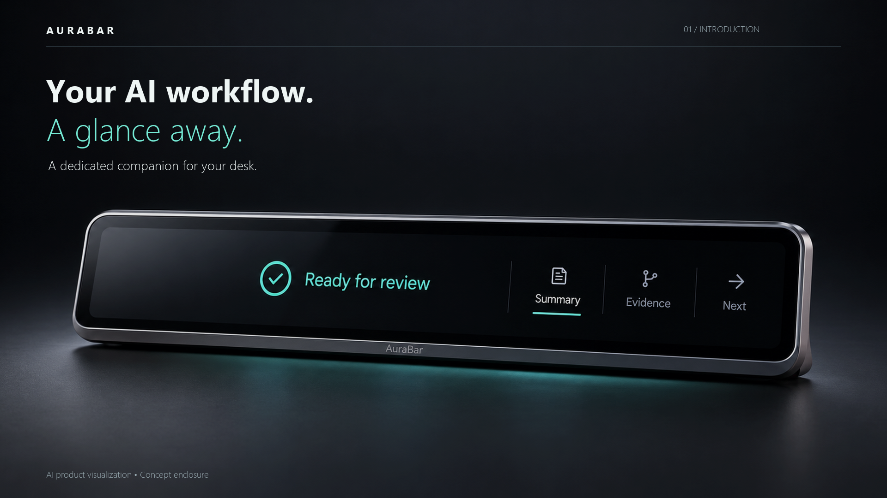
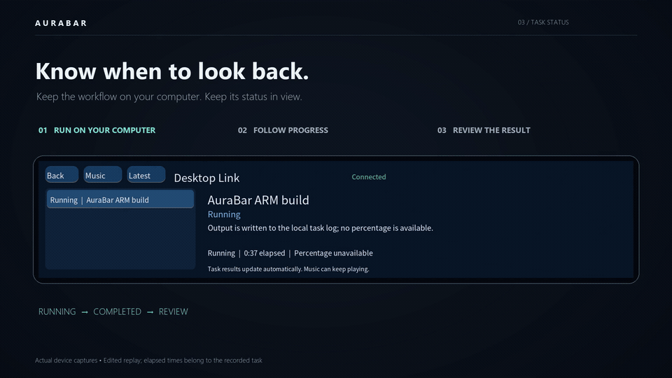
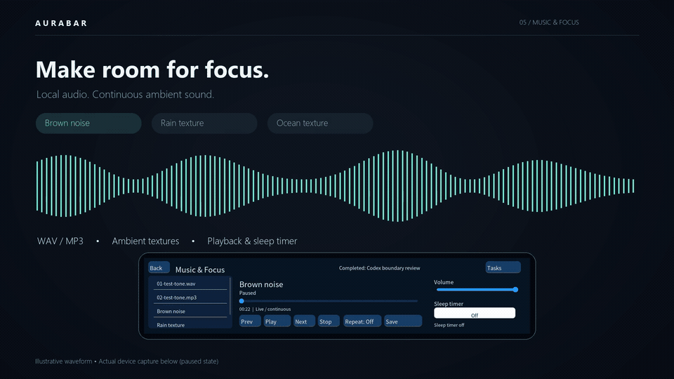
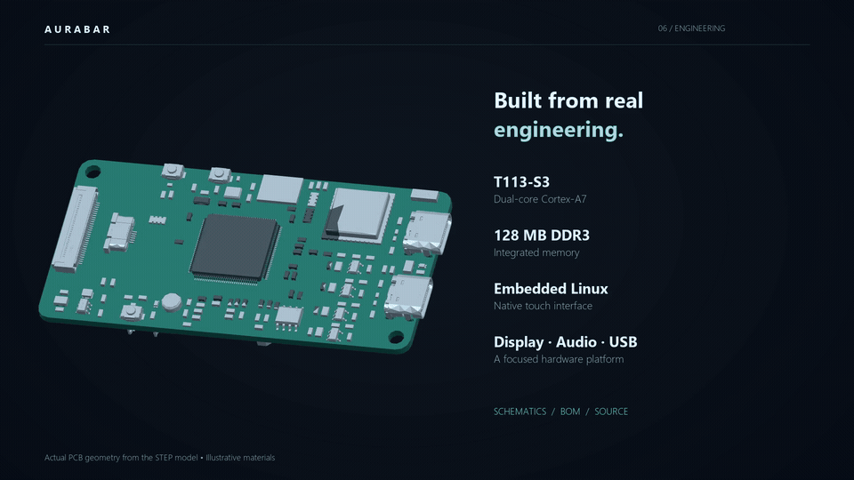
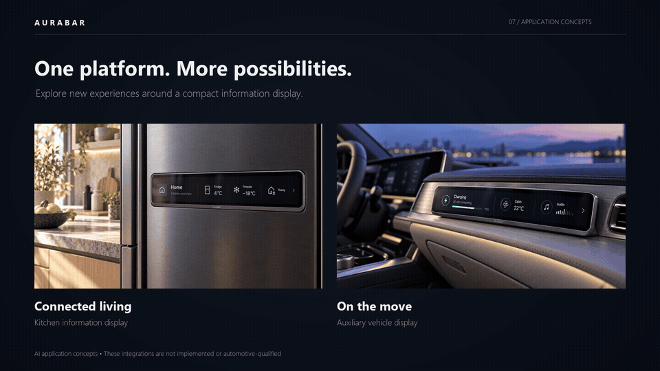

# Product film & demonstrations / 产品影片与演示

[Download or open the 60-second MP4 / 查看或下载完整影片](../../assets/demos/AuraBar-Product-Film-1080p.mp4)

1920×1080 · 30 fps · H.264/AAC stereo · original synthesized score · English on-screen titles. Optional [English subtitles](../../assets/demos/AuraBar-Product-Film.en.srt) and [Chinese subtitles](../../assets/demos/AuraBar-Product-Film.zh-CN.srt). No spoken narration. GitHub may offer a download instead of an inline player; a YouTube link will be added after publication.

60 秒完整影片，含原创合成配乐、英文画面标题与可选中英文字幕，无旁白。GitHub 可能以下载形式打开 MP4；YouTube 发布后再补充播放链接。

| Time / 时间 | Chapter / 章节 | Evidence type / 内容性质 |
|---|---|---|
| 00–14 s | Product and desk / 产品与桌面 | AI concept render with motion / AI 概念图动态编排 |
| 14–22 s | Task workflow / 任务流程 | Edited real device captures; separate build/review tasks / 真实截图剪辑、不同任务 |
| 22–30 s | Summary / Evidence / Next | Illustrated static-review handoff / 静态审查结果示意 |
| 30–38 s | Music & focus / 音乐专注 | Illustrative waveform and actual paused capture / 示意声波与真实暂停截图 |
| 38–46 s | Engineering / 硬件工程 | Real STEP-derived PCB geometry; illustrative materials / 真实 PCB 几何、示意材质 |
| 46–54 s | Connected living and vehicle / 家居与车辆 | Application concepts, integrations not implemented / 应用概念、未完成接入 |
| 54–60 s | Project invitation / 项目入口 | Concept product visual / 产品概念视觉 |

## Feature clips / 功能短片

GIFs are 960×540, 10 fps and loop automatically. They are product presentation material, not continuous live recordings. / GIF 自动循环，属于产品展示素材，并非连续实时录屏。

### Task workflow / 任务流程

### Music & focus / 音乐与专注

### Actual hardware geometry / 真实硬件几何

### Application concepts / 应用概念

## Use and interpretation / 使用说明

The film combines imagegen concept visuals, programmed motion graphics, existing framebuffer captures, STEP-derived geometry and an original synthesized soundtrack. It does not imply new physical acceptance, on-device model inference, a production enclosure or automotive qualification. The score is not a board recording. Source captures remain unmodified inside their presentation frames.

影片由 AI 概念视觉、程序动画、既有实机截图、STEP 几何与原创合成配乐组成，不表示新增实机验收、板端模型推理、定型外壳或车规认证；配乐不是板端录音，展示框内保留原始截图。

Published files have SHA-256 records in the [asset manifest](../../assets/manifest.json). Licenses and third-party notices remain scoped by [repository notices](../../THIRD_PARTY_NOTICES.md). Use the [current capability matrix](status.md) for procurement or integration evaluation.
