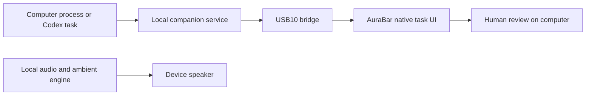

# Integration brief / 企业集成说明

AuraBar is a documented embedded display platform for a focused product loop: run work on a computer, present its status on a dedicated screen, read the result and return to the computer for decisions. Local audio extends its usefulness between tasks.

AuraBar 是围绕明确使用闭环设计的嵌入式显示平台：电脑执行、屏幕关注、结果阅读、电脑决策。本地音频让设备在任务之外也能持续发挥作用。

## Product value / 产品价值

| Need / 需求 | Platform response / 平台方案 | Evaluation evidence / 评估依据 |
|---|---|---|
| Persistent task awareness / 持续关注任务 | Actual process state, elapsed time and connection health / 真实进程状态、耗时与连接状态 | [Desktop Link](../software/release-0.3.0-alpha.1.md) |
| Actionable AI handoff / AI 结果交接 | Summary, evidence and next actions in separate cards / 摘要、证据与下一步分开呈现 | [Coding Companion](../software/release-0.4.0-alpha.2.md) |
| Everyday desk utility / 日常桌面用途 | Local audio, ambient textures, controls and timer / 本地音频、环境音、播放控制与定时 | [Music & Focus](../software/release-0.2.0-alpha.1.md) |
| Adaptable device UI / 可适配的设备交互 | Native LVGL application on Linux, with documented hardware / Linux 原生 LVGL 与有文档的硬件 | [Architecture](../architecture/README.md), [hardware](../hardware/README.md) |

## System boundary / 系统边界

The computer owns task execution, authentication to model services and approvals. The device presents bounded state and audio. The current path is a local development deployment, not a remotely managed fleet service. Root ADB used for bring-up is not a production security architecture.

电脑负责执行、模型服务认证与授权，设备负责有界信息展示及音频。当前路径面向本地工程环境，不是远程设备管理服务；调试用 root ADB 不能直接作为生产安全架构。

## Evaluation package / 评估资料

- [60-second film and feature clips / 产品影片与功能短片](demo.md).
- [Editable electronics, schematics and BOM / 电子工程、原理图和 BOM](../../hardware/README.md).
- [Device and companion source / 板端及电脑伴侣源码](../../software/README.md).
- [Reproduction workflow / 复现流程](../guides/reproduce.md), [installation and recovery / 安装与恢复](../guides/installation.md).
- [Protocol / 接口协议](../architecture/task-protocol.md), [validation / 验证记录](../testing/README.md), [version catalog / 版本目录](../releases/README.md).

## Integration options / 可集成方向

| Direction / 方向 | Existing base / 现有基础 | Project-specific work / 项目工作 |
|---|---|---|
| AI desktop companion / AI 桌面伴侣 | Task service, USB bridge, result cards, audio / 任务服务、USB、结果卡片与音频 | Workspace setup, target tool adapter, deployment / 工作环境、工具适配与部署 |
| Appliance or furniture interface / 家电家具交互 | Display, touch, Linux UI and electronics sources / 显示、触摸、Linux 界面与电子工程 | Device protocol, sensor/control integration, enclosure / 设备协议、传感控制与结构 |
| Auxiliary vehicle information / 车内辅助信息 | Concept visual and general display architecture / 概念视觉与通用显示架构 | Automotive power, interfaces, environment and qualification / 车用电源、接口、环境与验证 |

## From evaluation to deployment / 从评估到部署

1. **Baseline:** agree board revision, display, Tina image, SDK, companion OS and required functions. / 确认硬件、屏幕、系统、SDK、电脑环境与功能范围。
2. **Demonstration:** execute the [reproduction acceptance loop](../guides/reproduce.md), retain logs and confirm results on the physical unit. / 执行复现验收闭环，保存日志并确认实物结果。
3. **Pilot:** define autostart/recovery, security, resource licensing, burn-in and update behavior for the target deployment. / 试点明确自启动、恢复、安全、资源许可、稳定性与升级行为。
4. **Production:** establish manufacturing tests, qualification, supplier control and support responsibilities before a delivery commitment. / 交付前建立生产测试、适用性验证、供应链与支持责任。

Current software remains **0.4.0-alpha.2**. The [capability matrix](status.md) is the source of truth for acceptance. There is no claimed SLA, certification, fleet-management service or completed production qualification.

当前软件为 **0.4.0-alpha.2**，[能力状态表](status.md)是验收范围依据。仓库不宣称已具备 SLA、认证、设备集群管理或量产验证。

For an initial non-confidential discussion, [open an issue](https://github.com/TYF009/AuraBar-T113S3/issues/new/choose) describing the application, target interfaces, environment and success criteria. Review [licenses and notices](../../LICENSE) before reuse.
