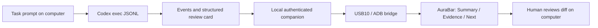

# AuraBar Coding Companion

中文定位：键盘旁的 AI 编程任务伴侣，帮助使用者知道 AI 做到哪里、何时需要检查、下一步要做什么。
固定 T113-S3 硬件负责触摸、信息显示和音频；电脑运行 Codex、任务适配器和 USB 桥。

## A complete first workflow

1. Start the authenticated companion and USB bridge on the computer.
2. Start one Codex task from the local companion CLI with a UTF-8 prompt file.
3. Follow actual Codex events on AuraBar: connection, work, commands and file updates.
4. On completion, read Summary / Evidence / Next, then inspect code on the computer.
5. Continue using the existing Music page and focus tools between tasks.

The product focuses on attention and review, rather than displaying a full chat or code editor.
No local model download is needed for this edition. Codex runs on the computer using
the user's existing CLI configuration, login, network connection and account limits.

## Evidence rules

- Task completion means the Codex process exited zero, emitted turn.completed without
  turn.failed, and produced a valid schema-constrained result card.
- If Codex reports outcome=blocked, the task is marked failed/Blocked rather than
  completed even when the CLI exited zero. This is an AI-reported blocker, not a
  complete automatic validator of whether the task met every requirement.
- The card summary, changes, verification notes and next steps are AI-generated.
  They are not independent proof of correctness or human acceptance.
- Command counts and exit codes come from command_execution events and are deduplicated
  by item id. A command exiting zero does not establish which tests ran or their coverage.
- No percentage is invented. Unknown progress remains null, including the review card.
- A failed command may be followed by a successful turn; the Evidence card retains the
  nonzero exit count so it remains visible during review.
- Raw command strings, command output, credentials and pairing tokens are not sent to
  the screen by the adapter. AI summaries may still contain project information; full
  prompts, event logs and results stay in a user-selected local directory.
- A stale USB snapshot is marked disconnected. It is not shown as live progress.

## Scope of 0.4

Implemented: one local Codex launch per invocation, real event mapping, bounded UTF-8
cards, local result/log files, unknown-progress handling, time limit, local cancellation,
USB transport and the three card tabs. Multiple invocations can use the existing bounded
eight-task service. One invocation represents one Codex turn.

Not included: automatic attachment to every conversation in the desktop Codex app,
two-way prompts from the screen, approval buttons, screen-side cancellation, persisted
service history, durable completion delivery, a test-suite-specific results parser,
or automatic startup. Approvals and diff review stay on the computer. In noninteractive
CLI mode, an action needing unavailable approval can fail; it does not become a supported
screen approval flow.

Future iterations should add a dedicated test runner adapter, configurable notification
policy, and explicit task-control APIs before screen buttons can launch or stop work.
MCP device actions and an app-server conversation client are separate later integrations.

## Official interface references

- [Codex noninteractive JSONL and output schema](https://learn.chatgpt.com/docs/non-interactive-mode)
- [Codex App Server for future interactive integration](https://learn.chatgpt.com/docs/app-server)

See [setup and commands](../../software/companion/README.md).
