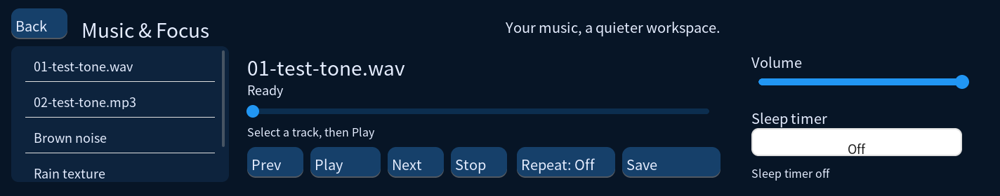

# Music & Focus 0.2.0-alpha.1

验收日期：2026-10-25。适用现有 AuraBar T113-S3 板卡、外壳及已验证的 Tina 显示固件。

这是可运行的应用预览版。完整系统镜像、商业交付验收和后续 AI 版本仍需继续推进。

## 已完成

- 音乐页：本地 WAV/MP3、直接 MP3 网络流、播放/暂停、前后曲、本地进度跳转、队列循环、收藏和睡眠定时。
- 三种合成环境音：棕噪声、雨声质感、海浪质感；后两者属于合成音，并非自然录音。
- 保留时钟、天气、待办、闹钟、番茄钟的现有界面。
- 修正存储原子写入、线程与界面边界、消息队列、倒计时、音频资源协调和构建失败处理。
- 提供版本配置、回归测试、应用打包、逐文件 SHA256 校验和独立安装工具。

## 实测证据

- Ubuntu 回归测试通过，包含本地 MP3/WAV、HTTP 成功与 404、暂停/跳转、通知协调、存储、消息队列和倒计时。
- ARM 全量编译通过；板卡上的存储、队列、倒计时和音乐控制测试通过。
- 实际扬声器分别播放约 3 秒的低音量 WAV/MP3 测试音，用户确认两段均可听到、界面正常。
- 最终安装二进制 SHA256 与主机文件一致：
  `734fbee7664f290ff7b8e49256d9c715afb9c57b2a9a5588ad9513ce1b07ace7`。
- 升级包包含 137 个经过清单校验的文件。校验工具无需解压即可检查所有文件及包本身。

## 安装与回退边界

升级包是 application-upgrade，不是可供 PhoenixSuit 烧录的镜像。
开发板上的新程序独立安装为 `/usr/bin/aurabar-music-focus-0.2.0-alpha.1`，旧的 `/usr/bin/demo` 保留。
没有切换开机启动配置。重启仍遵循原系统配置；临时测试音乐位于 /tmp，重启可能丢失。
安装工具要求已有匹配的 /usr/res 资源，不会自动覆盖旧资源或切换启动项。

## 下一轮验收

1. 逐项触摸验收：播放、暂停、跳转、收藏、音量、睡眠菜单和返回主界面。
2. 音乐与番茄钟/闹钟同时工作时的真实扬声器抢占与恢复。
3. Wi-Fi 断开重连、天气异常、真实 HTTPS MP3 流及证书链。
4. 长时间播放、内存与 CPU 峰值、异常掉电及冷启动。
5. 增加曲库刷新、收藏筛选、元数据与封面，再完善可复现的完整固件。

当前不支持蓝牙音频、HLS/AAC、DRM 音乐平台、歌词、封面或 AI 功能。
GitHub Actions 配置已加入，远端执行结果应在推送后查看；本地验证不等同于远端 CI 已通过。
