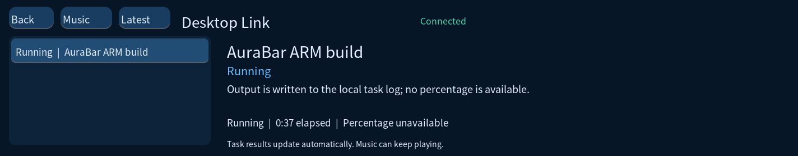
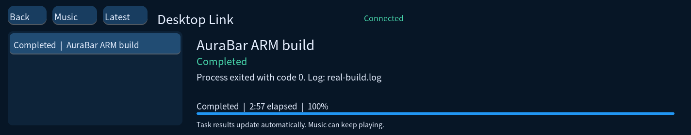
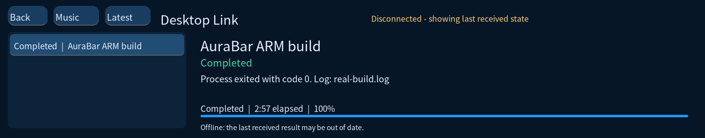
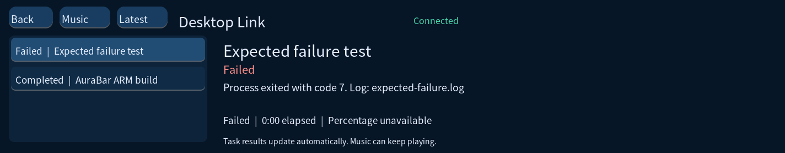

# Desktop Link 0.3.0-alpha.1

验收日期：2026-10-25。继承 Music & Focus 应用基础，增加电脑任务状态屏。
这是应用预览版，不是可烧录的完整系统镜像，也尚未内置 AI 模型。

## 本轮完成

- Python 标准库电脑端服务，默认仅监听本机，使用随机令牌鉴权。
- 本地命令包装器：实际启动进程、保存本地日志、报告运行与退出结果。
- 外部任务 report 接口：供后续 AI、视频生成和构建适配器上报真实阶段。
- 通过现有 USB10/ADB 原子同步状态，无需为首次体验配置 Wi-Fi。
- 板卡独立任务页面：任务列表、阶段、经过时间、结果说明及已知百分比。
- 心跳过期后标记断线，保留旧数据；恢复连接后自动同步。
- 完成通知去重；首次载入历史记录、服务重启时不重复提示旧结果。
- 音乐页与任务页互相切换，音乐后端保持运行；音乐页显示最新任务状态。
- 修补旧主页删除时的刷新/时钟计时器清理，避免残留回调。

## 实机与回归证据

真实 ARM 全量构建运行约 2 分 57 秒，板卡先显示 Running，进程退出 0 后显示 Completed。
构建运行中没有提供百分比，屏幕明确显示 Percentage unavailable。

停止 USB 状态桥后，板卡将状态标记为 Disconnected，并提示当前显示的是旧数据。
恢复状态桥后，实际板卡探针重新读到 connected=1；历史结果未产生探针通知。

真实执行一个主动退出 7 的测试进程，板卡显示 Failed 和相同退出码。

Windows 与 Ubuntu 的电脑端测试通过，覆盖鉴权、令牌稳定性、真实进程退出状态、
任务容量及不淘汰运行中任务。C 模型测试覆盖无效状态、越界数据、未知进度、
心跳过期、服务重启及通知去重；实际 C HTTP 轮询客户端测试覆盖鉴权、完成事件、
断线和服务重启恢复。原有音乐、存储、消息队列与倒计时回归测试继续通过。
ARM 任务模型测试在实物运行通过。
最终电脑端包含 5 项测试，并通过实际命令包装器再次在 Windows 执行成功。
应用包的 139 个文件通过清单校验。最终安装二进制 SHA256 与主机文件一致：
`1ff410205b33572d1025a8fd40106a504a5f34ae9859b4727c923ae0c0102565`。

用户已确认环境音正常，以及一次 Music 到 Tasks 的页面切换正常。
后续抓取曾出现时钟页，已补齐旧主页计时器的页面生命周期清理；
新版实机随后成功抓取任务完成、断线、失败画面。完整触摸路径仍需继续验收。
音乐与完成提示的实际听感、提示后恢复情况仍待用户最后确认；
软件级音乐/通知协调及事件去重已通过自动测试，不能替代实际听感验收。

## 使用与限制

参见 [电脑端与 USB 连接说明](../../software/companion/README.md)。
本轮实物使用 USB 状态桥；HTTP 客户端在主机自动化测试中验收，Wi-Fi 尚未实机验收。
电脑端历史保存在内存中，服务重启后会清空；它不会恢复已在外部运行的任务。
服务中断时的完成上报不具备持久重试队列；USB 中断可在重连后读取最新服务状态。
命令默认只有开始、运行和结束阶段。更细的进度必须由真实任务适配器提供。
没有远程执行命令、屏幕取消任务或自动切换开机启动配置。
原 /usr/bin/demo、0.2 音乐预览程序及其发布草稿保留。
