# AuraBar Hardware Design Handbook / 硬件电路设计手册

**English first, followed by Chinese in each subsection. / 每个小节先英文，后中文对照。**

This handbook explains the AuraBar board from requirements through component selection, circuit behavior and bring-up. It preserves every unique image embedded in the original Word notes and adds the seven final schematic sheets so that historical reasoning can be compared with the released electronics sources. Start with the [product architecture guide](../../docs/hardware/README.md) for the product-level view.

本文从需求、器件选型、电路行为到调试说明 AuraBar 主板。原始 Word 中全部独立图片均予保留，同时加入最终原理图七个图页，便于比较设计推导与当前电子设计资料。产品层面的说明见[硬件架构指南](../../docs/hardware/README.md)。

| Design record / 设计记录 | Baseline / 基线 |
|---|---|
| Project / 项目 | AuraBar, internal name `6.22_Screen` |
| Controller / 主控 | Allwinner T113-S3; dual Cortex-A7, HiFi4 DSP, 128 MB DDR3 in-package |
| Electronics / 电子设计 | LCEDA Pro; Board1 / Schematic1; schematic V1.0 |
| Sheets / 图页 | T113S3 · NET · POWER · CONNECT · AUDIO · FLASH · DISPLAY |
| Input / 输入 | Regulated 5 V USB / 稳压 5 V USB |
| Source images / 原始图片 | 26 unique Word images, 27 placements; one reused image / 26 张独立图，27 处引用，其中一张重复 |
| Evidence / 依据 | [PDF](../schematic/AuraBar-Schematic-v1.0.pdf), [BOM](../bom/AuraBar-BOM-v1.0.csv), [netlist](../schematic/netlist.net) |

**Reading the figures.** “Original note” means a preserved historical illustration; its designators or alternatives can differ from the final export. “Final sheet” means a raster preview of the repository PDF, with the vector PDF linked for full-detail inspection. Text and callouts inside original images retain their source language. See the [figure index and SHA-256 mapping](figure-index.md) for complete coverage.

**图示阅读方式。**“原始说明图”表示保留的历史图示，位号与备选器件可能与最终导出不同；“最终图页”表示仓库 PDF 的栅格预览，查看细节可打开矢量 PDF。原图内的文字保留原始语言。全部图片覆盖情况及 SHA-256 对应关系见[图像索引](figure-index.md)。

## Contents / 目录

- [1. SoC selection / 主控选型](#1-soc-selection--主控选型)
- [2. Minimum system / 最小系统](#2-minimum-system--最小系统)
- [3. DDR configuration / DDR 配置](#3-ddr-configuration--ddr-配置)
- [4. Power generation and decoupling / 电源与去耦](#4-power-generation-and-decoupling--电源与去耦)
- [5. Final controller sheet / 最终主控图页](#5-final-controller-sheet--最终主控图页)
- [6. Storage and recovery / 存储与恢复](#6-storage-and-recovery--存储与恢复)
- [7. USB and supply direction / USB 与供电方向](#7-usb-and-supply-direction--usb-与供电方向)
- [8. Keys and serial diagnostics / 按键与串口诊断](#8-keys-and-serial-diagnostics--按键与串口诊断)
- [9. Audio input and output / 音频输入与输出](#9-audio-input-and-output--音频输入与输出)
- [10. Wireless connectivity / 无线连接](#10-wireless-connectivity--无线连接)
- [11. Display touch and backlight / 显示触摸与背光](#11-display-touch-and-backlight--显示触摸与背光)
- [12. PCB and bring-up review / PCB 与调试审查](#12-pcb-and-bring-up-review--pcb-与调试审查)
- [13. Source corrections / 来源差异与修正](#13-source-corrections--来源差异与修正)
- [14. Components and source documents / 器件与设计资料](#14-components-and-source-documents--器件与设计资料)

## 1. SoC Selection / 主控选型

The T113-S3 combines application processing, an integrated audio codec and display interfaces with 128 MB DDR3 in one package. This allows the board to run Linux and a native touch interface without routing a separate DDR memory package. The leaded 128-pin package also makes inspection and prototype rework practical. The BOM footprint is named `TQFP-128`; the original narrative describes the package as LQFP128. Use the actual mechanical land pattern and exposed-pad requirements when manufacturing.

T113-S3 将应用处理器、音频 codec、显示接口与 128 MB DDR3 集成在同一封装内，使板卡可以运行 Linux 和原生触摸界面，同时减少独立 DDR 封装的互连布线。128 引脚引线封装也便于检查和原型返修。BOM 封装名称为 `TQFP-128`，原始文字称 LQFP128；制造时应核对实际焊盘尺寸与裸露焊盘要求。

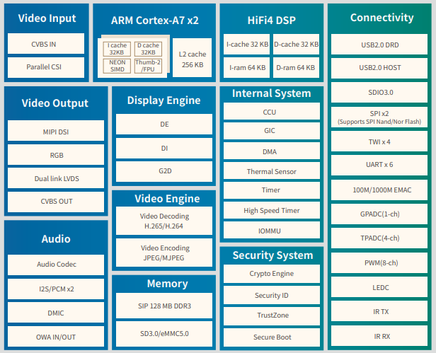

*Original Word image 1: silicon capabilities. / Word 原图 1：芯片资源。*

The feature list describes silicon resources, not automatically delivered product functions. The current application uses display, touch, audio and USB task communication. DSP acceleration, video pipelines and microphone-based AI assistants require their own software and acceptance work.

参数图表示芯片资源，不等于产品已交付功能。当前应用使用显示、触摸、音频与 USB 任务通信；DSP 加速、视频链路与麦克风 AI 助手仍需各自的软件实现与验收。

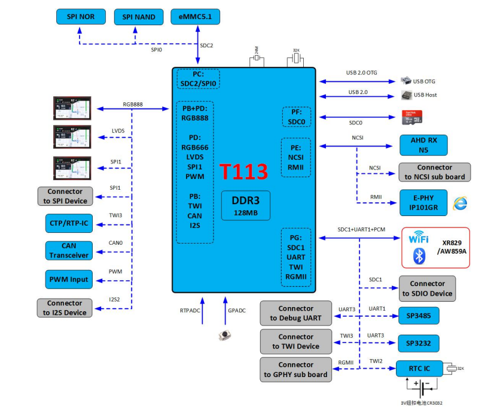

*Original Word image 2: controller architecture reference. / Word 原图 2：主控架构参考。*

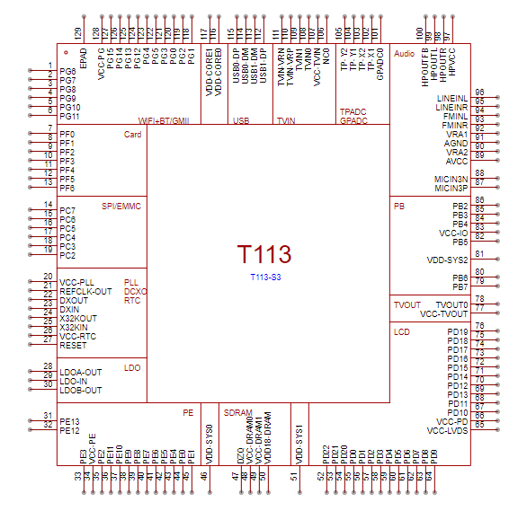

*Original Word image 3: multi-part symbol used to organize power and interface pins. / Word 原图 3：通过多部分符号组织电源与接口引脚。*

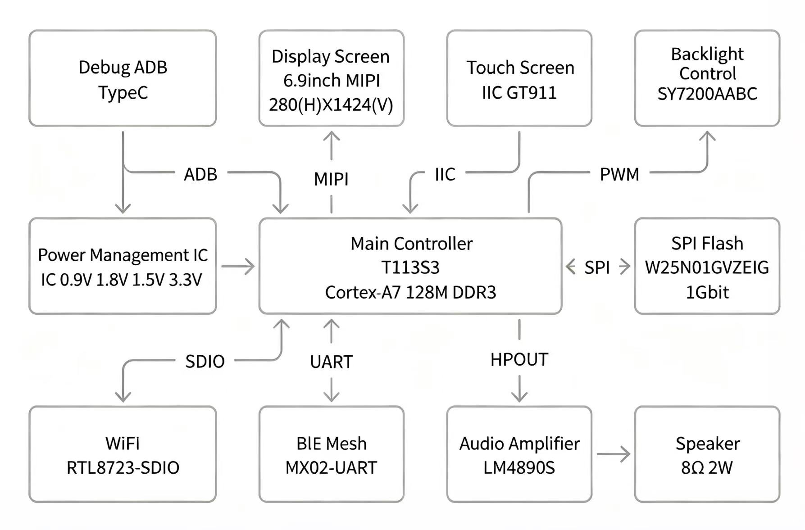

*Additional historical reference. It shows earlier SY7200AABC and LM4890S choices; the current BOM uses MT9201 and LM4871. / 补充历史参考图：其中 SY7200AABC 与 LM4890S 为早期选择，当前 BOM 为 MT9201 与 LM4871。*

For product design, the useful combination is a compact local interface and a more capable computer-side AI service. Keep large models and project context on the host; use the board for state, result cards, touch and sound. The 128 MB RAM budget makes bounded buffers, limited image caches and controlled service counts important.

产品设计上，可将紧凑的板端界面与电脑端 AI 服务组合：模型和项目上下文留在主机，板卡负责状态、结果卡片、触摸与声音。128 MB 内存条件要求缓冲区、图片缓存和常驻服务数量保持可控。

## 2. Minimum System / 最小系统

The minimum system comprises the clock sources, reset, supply rails, DDR configuration and boot storage. Diagnose these before adding display or application complexity. A valid boot log is stronger evidence of startup progress than a power indicator alone.

最小系统由时钟、复位、电源轨、DDR 配置与启动存储构成。应先确认这些基础，再排查显示或应用功能。电源灯只能说明局部供电存在，启动日志更能反映系统启动进展。

### 2.1 Main clock / 主时钟

The design uses a 24 MHz crystal X1, YXC XL2EL89COI-111YLC-24M, with a ±10 ppm selection target. In the final netlist, DXOUT is T1 pin 22 and DXIN is pin 23; the load capacitors are **C122/C123, 12 pF**. The historical screenshot uses different capacitor designators.

设计使用 24 MHz 晶体 X1，型号为扬兴 XL2EL89COI-111YLC-24M，选型目标为 ±10 ppm。最终网表中 DXOUT 为 T1 的 22 脚、DXIN 为 23 脚，负载电容为 **C122/C123，12 pF**；历史截图的电容位号不同。

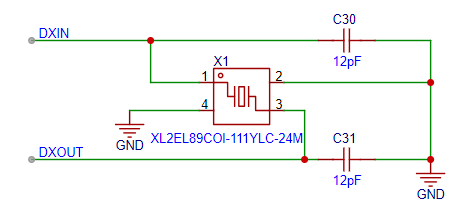

*Original Word image 4; also reused in the Word RTC discussion. C30/C31 in this historical figure are not the final clock-capacitor designators. / Word 原图 4，在 RTC 说明处重复使用过一次；图中 C30/C31 不是最终主时钟电容位号。*

Crystal load is approximately `CL = C1*C2/(C1+C2) + Cstray`; two 12 pF capacitors do not imply a 12 pF effective load. Include oscillator-pin and PCB parasitics, then verify startup margin and frequency with suitable low-loading measurement methods. Keep the crystal loop short and away from switching nodes. REFCLK-OUT is unused in this design.

晶体等效负载近似为 `CL = C1*C2/(C1+C2) + Cstray`，因此两颗 12 pF 电容不等于 12 pF 有效负载。需计入振荡器引脚与 PCB 寄生，再使用低负载测量方法验证起振裕量与频率。晶体回路应短，并远离开关节点。本设计未使用 REFCLK-OUT 扇出。

### 2.2 RTC clock / RTC 时钟

X2 is a 32.768 kHz crystal, YXC X321532768KGD2SI, connected to X32KOUT/X32KIN on pins 24/25. C120/C121 are 12 pF and R14 is 10 MΩ across the oscillator nodes. The high-value resistor provides a feedback/bias path; it should not be described as an adjustable frequency-trimming element. Frequency depends on the crystal and effective loading.

X2 为扬兴 X321532768KGD2SI、32.768 kHz 晶体，连接 X32KOUT/X32KIN 的 24/25 脚；C120/C121 为 12 pF，R14 为跨接振荡节点的 10 MΩ 电阻。高阻电阻提供反馈或偏置通路，不宜解释成可调的频率微调元件；频率取决于晶体与实际负载。

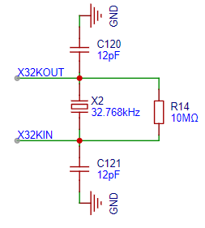

*Original Word image 5: crystal, loading and feedback path. / Word 原图 5：晶体、负载与反馈通路。*

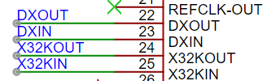

*Additional pin reference; retain the node names when tracing the final schematic. / 补充引脚参考，核对最终原理图时按网络名追踪。*

### 2.3 Reset / 复位

T1 RESET pin 27 has R13 = 10 kΩ pull-up, C41 = 100 nF, ESD5451N U41 and manual key SW2. The nominal RC product is 1 ms, but reset release also depends on the input threshold and power ramp. It is not a guaranteed 1 ms reset pulse. Verify the reset waveform against rail startup and repeated power cycles.

T1 的 RESET 为 27 脚，电路使用 R13 = 10 kΩ 上拉、C41 = 100 nF、ESD5451N U41 与手动按键 SW2。标称 RC 乘积为 1 ms，但释放时刻还取决于输入阈值和电源上升过程，不能直接称为保证的 1 ms 复位脉宽。应结合各路电源启动及重复上电测量波形。

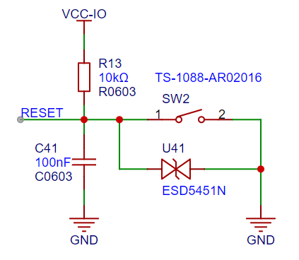

*Original Word image 6. The protection network is design intent, not evidence of a completed system ESD test. / Word 原图 6；保护网络表达设计意图，不代表已完成整机静电验收。*

## 3. DDR Configuration / DDR 配置

The S3 variant uses **128 MB DDR3 in-package with a 1.5 V DRAM supply**. R123 = 240 Ω, 1%, connects the DDR configuration/calibration pin 47 to ground. The final POWER sheet notes that VCC-PC/PF are internally connected to VCC-IO on T113-S3. Variant-specific supply requirements must follow the selected device, not a different T113 board example.

S3 型号包含 **128 MB 片内 DDR3，DRAM 使用 1.5 V 供电**；R123 = 240 Ω、1%，将 DDR 配置/校准相关的 47 脚接地。最终 POWER 图页注明 T113-S3 的 VCC-PC/PF 在芯片内部连接至 VCC-IO。供电要求应以所用型号为准，不能照搬其他 T113 板卡。

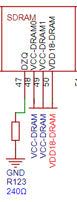

*Original Word image 13. / Word 原图 13。*

RAM and Flash have different roles. DDR stores runtime data; the 1 Gbit SPI NAND stores the system and files. Unstable memory behavior should prompt checks of the 1.5 V rail, configuration, reset and board assembly before blaming the UI.

RAM 与 Flash 职责不同：DDR 保存运行时数据，1 Gbit SPI NAND 保存系统和文件。若出现内存不稳定，应先检查 1.5 V 电源、配置、复位与装配，再判断是否为界面问题。

## 4. Power Generation and Decoupling / 电源与去耦

### 4.1 Power domains / 电源域

The board derives four supplies from its 5 V bus: 3.3 V for I/O and peripherals, 1.5 V for DDR, 0.9 V for core/system domains, and 1.8 V for the relevant analog/internal domains. The unused CSI supply in the original reference does not create an additional implemented rail here. Reference current budgets in the old notes are not measured board consumption or guaranteed rail ratings.

板卡由 5 V 总线产生四路电源：3.3 V 供 I/O 与外围电路，1.5 V 供 DDR，0.9 V 供核心及系统域，1.8 V 供相应模拟及内部电源域。原参考中的未用 CSI 电源不代表本板实现了额外电源轨；旧说明中的电流预算不能视为实测功耗或保证的输出能力。

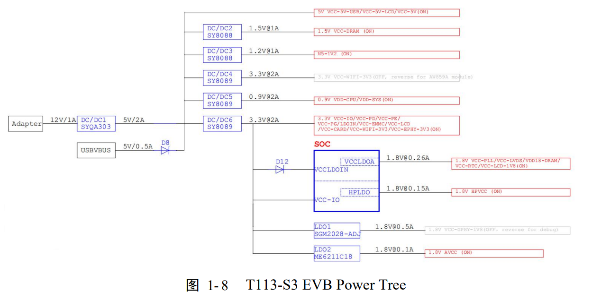

*Original Word image 7: vendor EVB reference. The EVB's 12 V input stage is not the AuraBar 5 V USB input design. / Word 原图 7：原厂 EVB 参考，其中 12 V 输入级不是 AuraBar 的 5 V USB 输入电路。*

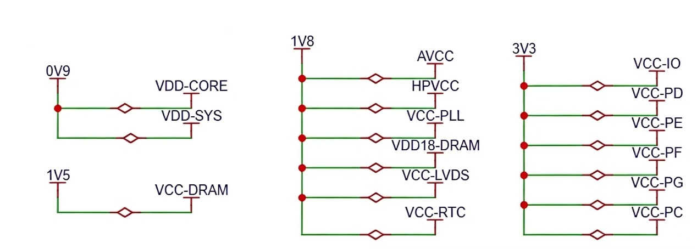

*Original Word image 10, preserved byte-for-byte. / Word 原图 10，按原始字节保留。*

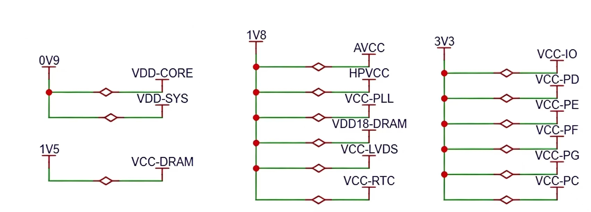

*Existing re-encoded copy retained for traceability; the preceding figure is the original Word media. / 保留已有重新编码版本用于追溯，上一张为 Word 原始媒体文件。*

### 4.2 Regulator choice and feedback calculations / 稳压器选型与反馈计算

An integrated PMIC can consolidate supply generation; separate regulators make prototype assembly and per-rail inspection straightforward. AuraBar's final BOM contains **four SY8088AAC devices, U1–U4**, with 2.2 µH L1–L4. The historical 1.8 V LDO option is not the current configuration.

集成 PMIC 可整合供电，独立稳压器则便于原型装配和逐路检查。AuraBar 最终 BOM 使用 **四颗 SY8088AAC，U1–U4**，配套 L1–L4 为 2.2 µH。历史上的 1.8 V LDO 方案不是当前配置。

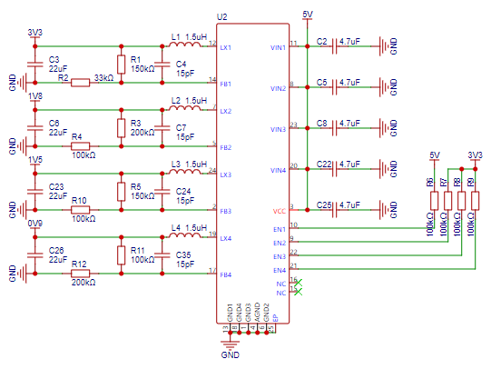

*Original Word image 8: alternative considered, not populated as the final power architecture. / Word 原图 8：设计阶段备选，不是最终电源架构。*

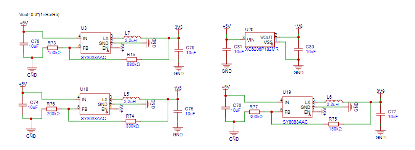

*Original Word image 9: early designators and an XC6206 1.8 V LDO. Use the final table and sheet below for current parts. / Word 原图 9：包含早期位号及 XC6206 1.8 V LDO，当前器件按下表与最终图页核对。*

Using the design equation `Vout = 0.6 * (1 + Rupper/Rlower)`, trace Rupper from output to FB and Rlower from FB to ground. The final netlist gives:

按设计公式 `Vout = 0.6 * (1 + Rupper/Rlower)`，上臂从输出接到 FB，下臂从 FB 接地。最终网表对应如下：

| Rail / 电源轨 | IC | Upper / 上臂 | Lower / 下臂 | Calculated nominal / 标称计算 |
|---|---|---|---|---|
| 3V3 | U1 | R2 = 680 kΩ | R1 = 150 kΩ | 3.32 V |
| 1V5 | U2 | R3 = 300 kΩ | R5 = 200 kΩ | 1.50 V |
| 0V9 | U3 | R4 = 150 kΩ | R6 = 300 kΩ | 0.90 V |
| 1V8 | U4 | R8 = 300 kΩ | R7 = 150 kΩ | 1.80 V |

These calculations explain nominal setpoints; resistor tolerance, reference accuracy, layout and load affect measured voltage. Earlier handbook values incorrectly listed R2 as 68 kΩ and reversed several divider roles. The BOM and netlist both identify R2 as 680 kΩ.

计算用于解释标称设定值，实测电压仍受电阻误差、基准精度、布局与负载影响。此前手册误写 R2 为 68 kΩ，并颠倒了部分分压电阻的角色；BOM 与网表均记载 R2 为 680 kΩ。

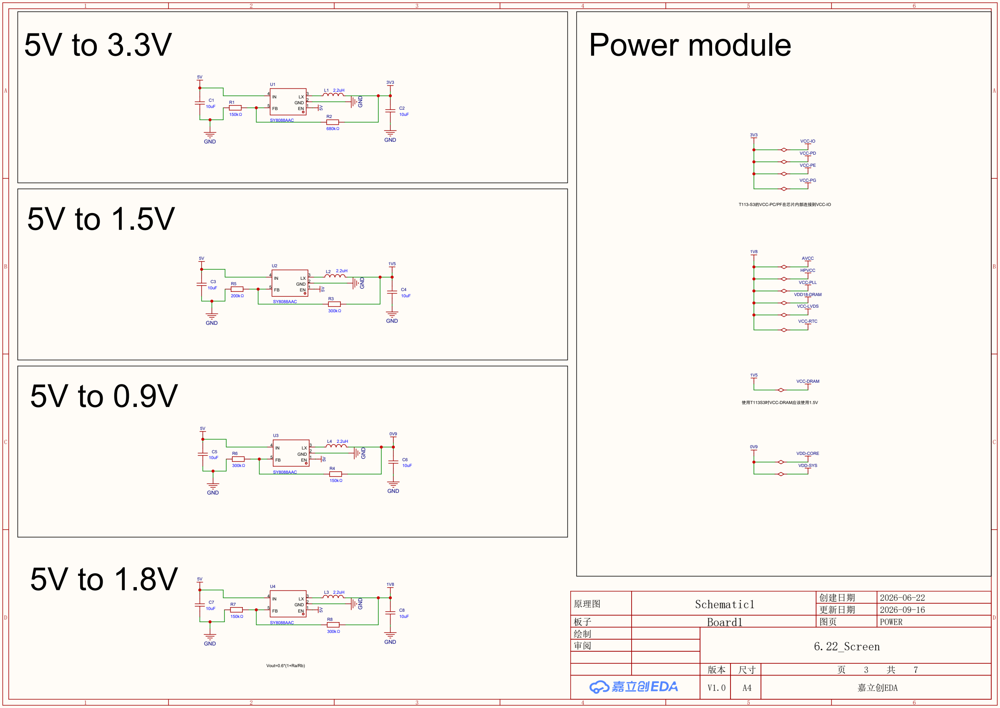

*Final schematic page 3. Open the [vector PDF](../schematic/AuraBar-Schematic-v1.0.pdf#page=3) to inspect connections at full detail. / 最终原理图第 3 页，细节见矢量 PDF。*

### 4.3 Filtering and layout / 滤波与布局

Place local decoupling near each supply pin and keep return paths short. Effective ceramic capacitance depends on dielectric, DC bias and package; capacitance values alone do not prove ripple performance. Avoid routing sensitive feedback or audio traces through switching-current loops. Check inductor saturation, regulator thermal behavior and stability with the actual load.

去耦应靠近各电源引脚，回流路径尽量短。陶瓷电容的有效容量受介质、直流偏压和封装影响，标称容值本身不能证明纹波性能。敏感反馈与音频走线应避开开关电流回路，并按实际负载检查电感饱和、稳压器温升与稳定性。

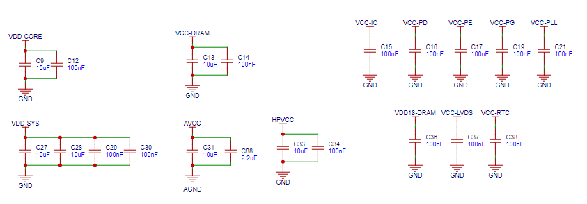

*Original Word image 11. / Word 原图 11。*

The design includes 0 Ω R79 between AGND and GND and a GZ1608D601TF ferrite bead L8, specified in the source as 600 Ω at 100 MHz, in the analog supply path. These organize/filter return and supply paths; they do not provide galvanic isolation. C82/C83 are 470 nF in the final BOM. Tune noise mitigation from measurements rather than assuming a bead suppresses every interference frequency.

设计在 AGND 与 GND 之间使用 0 Ω R79，模拟供电路径使用 GZ1608D601TF 磁珠 L8，原资料规格为 600 Ω@100 MHz。这些器件用于组织回流与滤波，不提供电气隔离。最终 BOM 中 C82/C83 为 470 nF。应依据实测调整噪声措施，不能认为一颗磁珠能抑制所有干扰频段。

The original notes also discuss the SoC's internal LDOs. They are not used as the final four-rail supply solution; do not substitute them without checking the relevant pin requirements, current budget, sequencing and device documentation.

原说明还讨论了主控内部 LDO，但最终四路供电方案未采用它们。若要替换，需重新核对引脚要求、电流预算、时序与芯片资料。

## 5. Final Controller Sheet / 最终主控图页

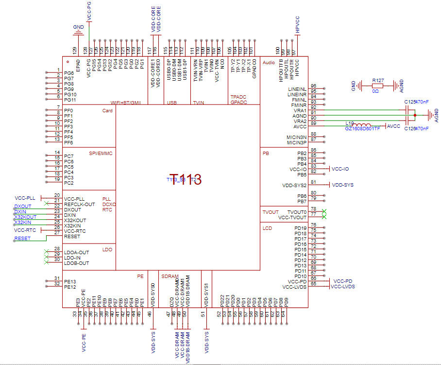

*Original Word image 12: controller design at the time of the notes. / Word 原图 12：设计说明阶段的主控电路。*

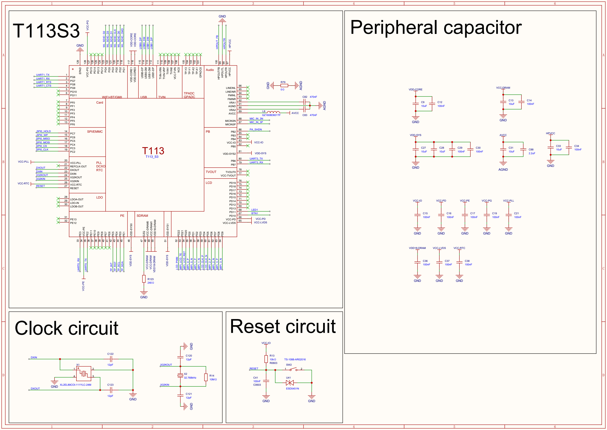

*Final schematic page 1: controller, clocks, reset and decoupling. [Vector PDF](../schematic/AuraBar-Schematic-v1.0.pdf#page=1). / 最终第 1 页：主控、时钟、复位与去耦。*

Read the controller sheet together with POWER and the netlist: net labels connect circuits across sheets. A disconnected-looking symbol is not necessarily an unconnected supply, and a package pin number is not a Linux GPIO number. Confirm pin multiplexing in the running BSP before using an interface.

主控图页需要与 POWER 和网表一起阅读：网络标签连接不同图页。图中看似分离的符号不一定表示电源未连，封装脚号也不等于 Linux GPIO 编号。使用接口前应核对运行 BSP 中的复用配置。

## 6. Storage and Recovery / 存储与恢复

The board uses **Winbond W25N01GVZEIG U6, 1 Gbit SPI NAND**, connected to SPI0. One Gbit corresponds to 128 MiB of nominal main-array storage; usable filesystem space is lower after system partitions, metadata and bad-block handling. Driver support must account for NAND geometry, ECC and bad-block management. Compatibility is more than matching capacity and pin count.

板卡使用 **华邦 W25N01GVZEIG U6、1 Gbit SPI NAND**，接至 SPI0。1 Gbit 对应主阵列标称 128 MiB，系统分区、元数据与坏块处理会占用空间。驱动必须正确处理 NAND 几何、ECC 和坏块；容量与引脚相同并不代表可以直接替换。

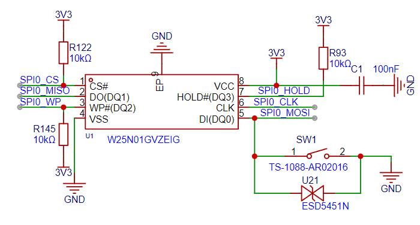

*Original Word image 14. / Word 原图 14。*

The final circuit pulls /WP and /HOLD high through R145/R93, both 10 kΩ, and uses R122 on /CS. /WP behavior depends on the device's protection registers and operating mode; it is not an unconditional “low means read-only” switch in every configuration. /HOLD is a serial-interface control whose behavior also depends on mode; it must not be confused with cancelling an internal NAND operation. Check the selected device documentation and driver configuration.

最终电路通过 R145/R93（均 10 kΩ）上拉 /WP 与 /HOLD，/CS 使用 R122。/WP 行为与保护寄存器及工作模式有关，不能概括为任何配置下“拉低就只读”。/HOLD 控制串行接口，行为也与模式有关，不等于取消 NAND 内部操作；应结合所用器件手册与驱动配置核查。

**SW1 is the Flash/FEL key; SW2 is reset.** Holding SW1 during the intended startup procedure affects SPI0 MOSI and prevents normal Flash detection, providing a recovery entry. Exact boot-ROM behavior and key timing should be verified on the selected image. An application upgrade archive is not a full bootable recovery image; see [installation and rollback](../../docs/guides/installation.md).

**SW1 为 Flash/FEL 按键，SW2 为复位。**在相应上电流程中按住 SW1，会影响 SPI0 MOSI 与正常 Flash 识别，从而提供恢复入口。具体 Boot ROM 行为与按键时序需在所用系统上验证。应用升级压缩包不是完整可启动恢复镜像，操作见[安装与回退](../../docs/guides/installation.md)。

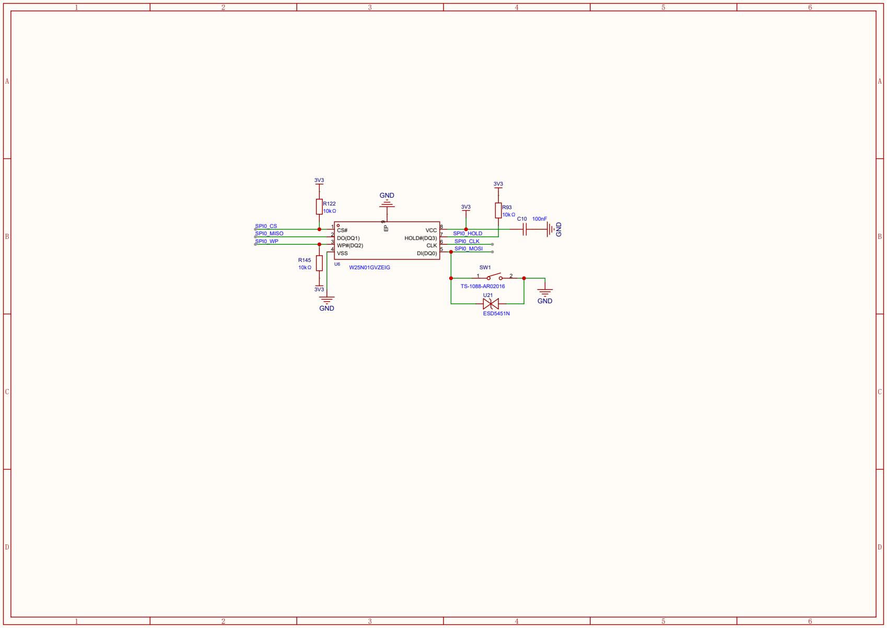

*Final page 6. [Vector PDF](../schematic/AuraBar-Schematic-v1.0.pdf#page=6). / 最终第 6 页。*

## 7. USB and Supply Direction / USB 与供电方向

### 7.1 Connector selection / 连接器选型

AuraBar uses two KH-TYPE-C-16P connectors, USB9 and USB10. The 16-pin footprint supports the USB 2.0 connections used here. Contact count alone does not establish speed, PD support, cable behavior or a complete Type-C role implementation.

AuraBar 使用两只 KH-TYPE-C-16P 连接器，位号为 USB9 与 USB10。16 针封装满足本板使用的 USB 2.0 连接，但触点数量本身不能证明速率、PD、线缆行为或完整 Type-C 角色实现。

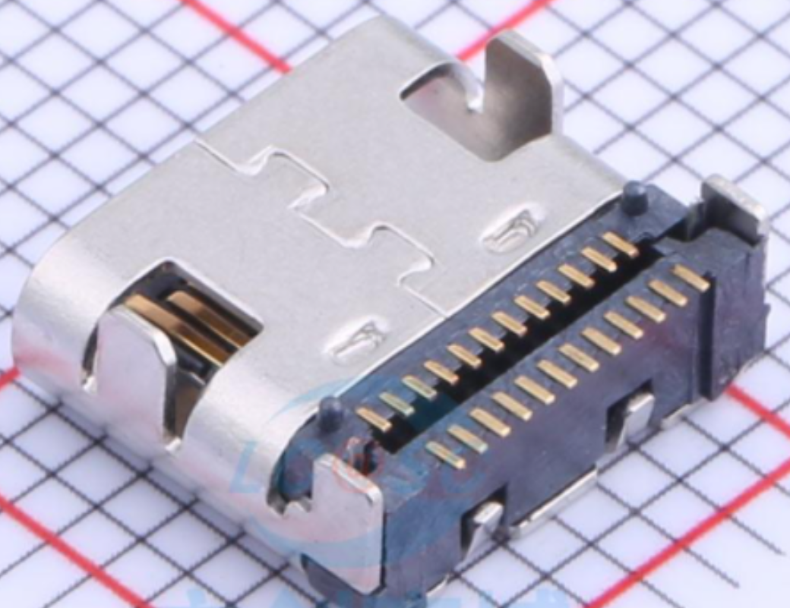

*Additional connector reference; not the board's selected footprint. / 补充连接器参考，不是本板所选封装。*

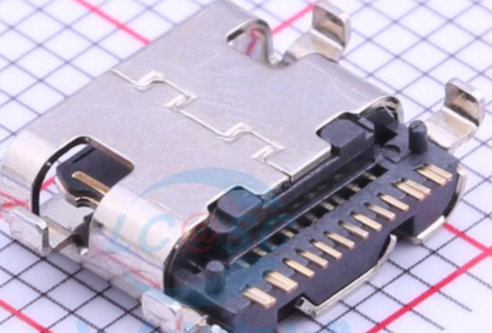

*Additional reference illustrating the selected connector class; verify the actual part drawing. / 补充参考，展示所用连接器类型，尺寸仍按具体器件图纸核对。*

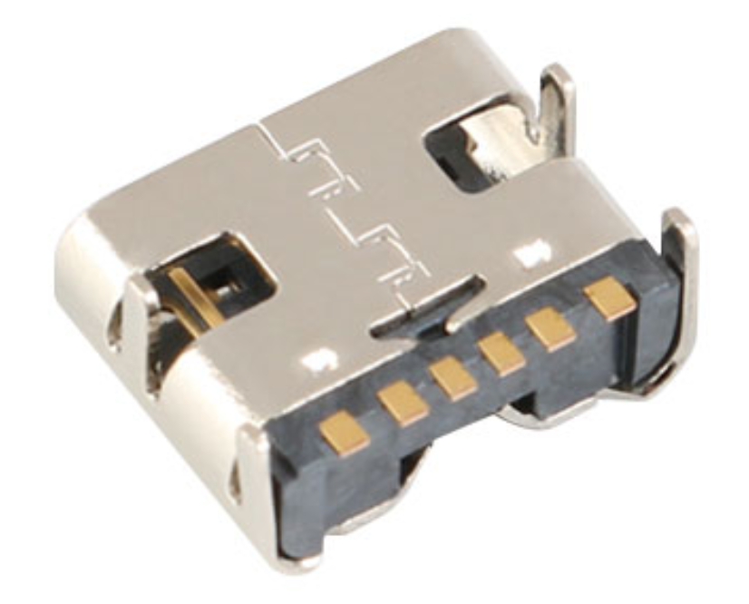

*Additional six-contact reference for the original comparison. / 补充六触点参考，用于保留原设计的方案对比。*

### 7.2 Port roles and CC resistors / 接口角色与 CC 电阻

| Connector / 接口 | Data / 数据 | Supply connection / 电源连接 | Current use / 当前用途 |
|---|---|---|---|
| USB10 | USB0 OTG | VIN5V → D23 → 5V | ADB, firmware tools, companion transport / ADB、烧录工具与伴侣通信 |
| USB9 | USB1 signals | VBUS directly on 5V bus / VBUS 直接接 5V 总线 | Main power input; other host uses require validation / 主供电，其他主机用途待验证 |

CC1/CC2 use separate 5.1 kΩ Rd pull-downs: R141/R142 at USB10 and R113/R114 at USB9. They indicate sink attachment; **they do not negotiate USB PD**. USB1 host-capable data signals together with sink CC wiring and an input VBUS connection do not form a validated standards-compliant host power port.

CC1/CC2 分别使用 5.1 kΩ Rd 下拉：USB10 为 R141/R142，USB9 为 R113/R114。它们声明取电端连接，**不执行 USB PD 协商**。USB1 的主机数据信号与取电端 CC、输入 VBUS 连接组合在一起，并不自动构成已验证的标准主机供电端口。

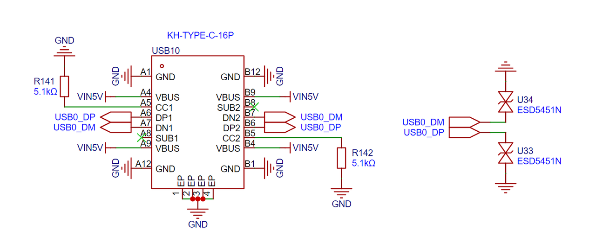

*Original Word image 15. / Word 原图 15。*

### 7.3 Supply isolation and losses / 供电隔离与损耗

The final netlist places **D23 between VIN5V and the system 5V bus**, anode at VIN5V and cathode at 5V. USB9 VBUS connects directly to the system bus. This is asymmetric supply isolation, not two independent diode OR-ing branches. **D22 is the backlight boost rectifier.**

最终网表中 **D23 位于 VIN5V 与系统 5V 总线之间**，阳极接 VIN5V、阴极接 5V；USB9 的 VBUS 直接接系统总线。因此这是不对称的供电隔离，不能描述为两条独立二极管 OR-ing 支路。**D22 是背光升压整流二极管。**

Check both single-cable and dual-cable supply conditions before declaring a supported connection combination. The diode does not provide automatic current sharing, negotiated source selection or complete reverse protection at every connector. Its approximate loss is `P = I * Vf`; voltage drop can matter during bright backlight and audio peaks.

应测量单线与双线连接条件，再确定支持的连接组合。该二极管不提供自动均流、协商式电源选择，也不能证明每个接口都具备完整反向保护。损耗近似为 `P = I * Vf`，高亮背光与音频峰值时需关注压降。

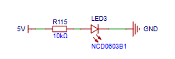

*Additional image: despite the historical filename, it shows LED3 and R115, not an OR-ing diode. / 补充图：尽管历史文件名包含 diode，实际内容是 LED3 与 R115，并非 OR-ing 二极管。*

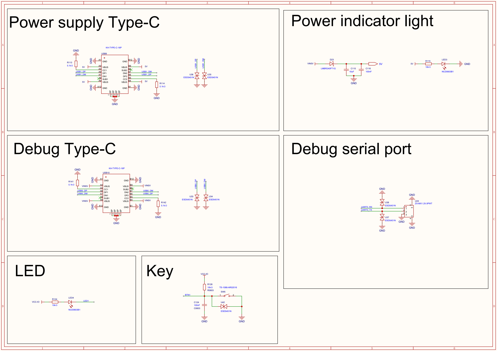

*Final page 4: both USB connectors, D23, indicator, keys and UART header. [Vector PDF](../schematic/AuraBar-Schematic-v1.0.pdf#page=4). / 最终第 4 页：双 USB、D23、指示灯、按键与串口。*

## 8. Keys and Serial Diagnostics / 按键与串口诊断

LED1 is the signal name on PD11; its physical LED is LED4 with R124. BTN1 is PD10, SW5, with C124 = 100 nF and U42 protection. Signal aliases and component designators are different identifiers. Software should still handle debounce and decide the button action explicitly.

LED1 是 PD11 上的信号名，实际器件为 LED4 与 R124；BTN1 使用 PD10、SW5，配 C124 = 100 nF 与 U42 保护。信号名和元件位号是两类标识。软件仍需处理消抖，并明确按键行为。

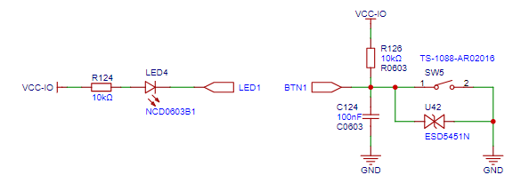

*Original Word image 16. / Word 原图 16。*

UART3 TX/RX on **PB6/PB7, T1 pins 80/79**, is routed to U24, a ZX-MX1.25-3PWT log header with U37/U38 protection. The console's actual baud rate and routing are BSP settings. UART1 is used for the wireless module; UART0 is connected to the optional U5 socket. Use a logic-level adapter matched to the interface, verify GND/TX/RX, and do not connect RS-232 voltage levels.

UART3 的 TX/RX 使用 **PB6/PB7、T1 的 80/79 脚**，接至 U24 日志口，型号为 ZX-MX1.25-3PWT，带 U37/U38 保护；实际控制台波特率与路由由 BSP 配置。UART1 用于无线模块，UART0 接至可选 U5 插座。应使用与接口电平匹配的适配器，核对 GND/TX/RX，不能接入 RS-232 电压。

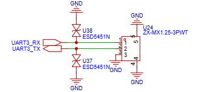

*Original Word image 17. / Word 原图 17。*

## 9. Audio Input and Output / 音频输入与输出

The signal paths are microphone → bias/filter/coupling → SoC codec, and codec HPOUTR → coupling/gain network → LM4871 → speaker. These paths support different acceptance tasks: playback has working software records, whereas a microphone voice assistant additionally requires capture, processing and application integration.

信号链分别为：麦克风 → 偏置/滤波/耦合 → 主控 codec，以及 codec HPOUTR → 耦合/增益网络 → LM4871 → 扬声器。两条链路对应不同验收任务：播放已有软件实机记录，麦克风语音助手还需要采集、处理与应用集成。

### 9.1 Microphone bias and filtering / 麦克风偏置与滤波

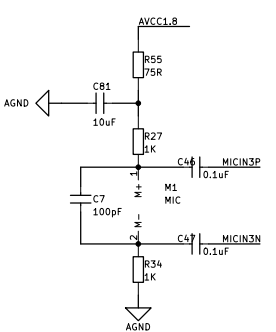

*Original Word image 18: reference designators such as C46/C47 and R27/R34 are historical. / Word 原图 18：C46/C47、R27/R34 等属于参考位号。*

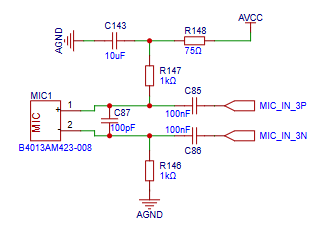

*Original Word image 19: later signal-chain illustration; the final component identity and values follow the AUDIO sheet. / Word 原图 19：后续信号链图示，最终器件身份与参数按 AUDIO 图页核对。*

| Element / 元件 | Final source value / 最终资料值 | Circuit role / 电路作用 |
|---|---|---|
| MIC2 | GMI4015P-2C-42db | Electret input transducer / 驻极体麦克风 |
| C85/C86 | 100 nF | AC coupling to MICIN3P/N / 交流耦合至差分输入 |
| R146/R147 | 1 kΩ each / 各 1 kΩ | Bias and return network / 偏置与回路网络 |
| C87 | 100 pF | Differential high-frequency shunt / 差模高频旁路 |
| R148 | 75 Ω | Supply-path series filtering / 供电串联滤波 |
| C143 | 10 µF | Filtered microphone supply decoupling / 滤波后麦克风电源去耦 |
| T1 pins / 引脚 | 87 / 88 | MICIN3P / MICIN3N |

For 100 nF, `|Xc| = 1/(2πfC) ≈ 1.59 kΩ at 1 kHz`, not 1.6 Ω. Low-frequency attenuation depends on the complete input impedance and coupling network. For an isolated unloaded 75 Ω / 10 µF RC section, `fc ≈ 212 Hz`; actual loading changes the response and introduces DC voltage drop.

100 nF 电容在 1 kHz 下的容抗为 `|Xc| = 1/(2πfC) ≈ 1.59 kΩ`，不是 1.6 Ω。低频衰减取决于完整输入阻抗与耦合网络。对孤立、无负载的 75 Ω / 10 µF RC 环节，`fc ≈ 212 Hz`；实际负载会改变响应，并带来直流压降。

A 100 pF capacitor has about 159 Ω reactance at 10 MHz; describing it as an ideal short above 10 MHz is too strong. Its attenuation depends on source impedance and parasitics. Likewise, changing microphone bias resistance does not guarantee increased sensitivity: verify bias current, operating voltage, headroom and recorded noise together.

100 pF 电容在 10 MHz 下容抗约 159 Ω，不能简单称为该频率以上的理想短路；衰减还取决于源阻抗与寄生。改变麦克风偏置电阻也不保证提高灵敏度，应同时验证偏置电流、工作电压、动态余量与录音噪声。

### 9.2 Amplifier topology and gain / 功放拓扑与增益

The final BOM uses **LM4871 U53**, SOIC-8, listed under IDCHIP with supplier code C7494970. The historical LM4890S circuit is retained to show the earlier choice. A similar part number is not proof of interchangeable pin behavior or guaranteed audio performance; procurement must match the assembled device's documentation.

最终 BOM 使用 **LM4871 U53**、SOIC-8，厂商栏为 IDCHIP，采购编码为 C7494970。保留 LM4890S 历史图以说明早期选择。相近型号不代表引脚行为或音频指标必然兼容，采购时需匹配实际装配器件资料。

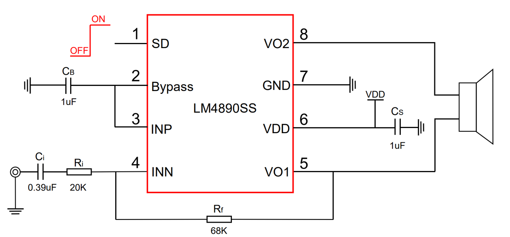

*Original Word image 20: early amplifier reference, not the final U53. / Word 原图 20：早期功放参考，不是最终 U53。*

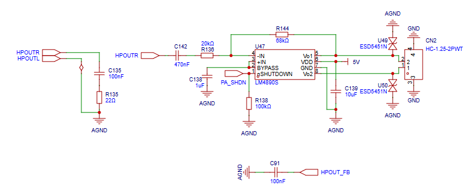

*Original Word image 21: still shows LM4890S and R144 = 68 kΩ. The filename does not make it the final circuit. Final design: LM4871 with R149 = 20 kΩ. / Word 原图 21：仍标注 LM4890S 与 R144 = 68 kΩ，文件名不代表最终版本；最终为 LM4871 与 R149 = 20 kΩ。*

The final netlist routes CN2 between VO+ and VO−: **both speaker wires are driven outputs**. Neither is a ground return. With the usual LM4871 bridge topology, 20 kΩ input and feedback resistors give an estimated differential gain magnitude of `2*Rf/Ri = 2` (about 6 dB). C142 = 470 nF with R136 = 20 kΩ gives an approximate input high-pass corner of 17 Hz, assuming negligible source impedance. These are topology estimates, not measured response.

最终网表将 CN2 接在 VO+ 与 VO− 之间，**扬声器两根线都是驱动输出**，均不是接地回路。按常见 LM4871 桥接拓扑，输入和反馈电阻均为 20 kΩ 时，差分增益幅值估算为 `2*Rf/Ri = 2`，约 6 dB；C142 = 470 nF 与 R136 = 20 kΩ 的输入高通拐点约为 17 Hz，假设源阻抗可忽略。这些是拓扑估算，不是实测响应。

The [TI LM4871 reference datasheet](https://www.ti.com/lit/ds/symlink/lm4871.pdf) explains the bridged output, external gain network and high-active shutdown. It is a topology reference; the BOM's listed supplier is different. Confirm the actual part before relying on pin thresholds or ratings.

[TI LM4871 参考手册](https://www.ti.com/lit/ds/symlink/lm4871.pdf)说明了桥接输出、外部增益网络与高电平关断；这里用于拓扑参考，BOM 所列供应厂商不同，具体阈值和额定参数仍须按实际器件核对。

C138 = 1 µF filters the bypass node; C139 = 10 µF decouples the amplifier supply. R138 = 100 kΩ pulls PA_SHDN low, and the netlist connects PA_SHDN to T1 PB2. For a high-active shutdown device, this pull-down defaults toward enabled operation, so it must not be described as guaranteed boot muting. Check power sequencing and software control for clicks/pops.

C138 = 1 µF 用于旁路节点滤波，C139 = 10 µF 用于功放供电去耦。R138 = 100 kΩ 将 PA_SHDN 下拉，网表中 PA_SHDN 接至 T1 PB2。若所用器件为高电平关断，下拉默认趋向使能，因此不能描述为保证启动静音；需要结合上电时序与软件控制检查爆音。

R135 = 22 Ω and C135 = 100 nF form a series RC branch from HPOUTR to ground. This is a frequency-dependent load/shunt branch, not by itself a conventional series-signal low-pass with a defined 22 Ω / 100 nF cutoff. Its effect depends on codec output impedance. C91 = 100 nF terminates HPOUT_FB according to the source design; confirm the codec's intended mode when changing this chain.

R135 = 22 Ω 与 C135 = 100 nF 串联后从 HPOUTR 接地，属于随频率变化的负载/旁路支路，本身不是可直接按 22 Ω / 100 nF 定义截止频率的常规串联信号低通；实际作用与 codec 输出阻抗有关。C91 = 100 nF 按原设计连接 HPOUT_FB，修改链路时需核对 codec 工作模式。

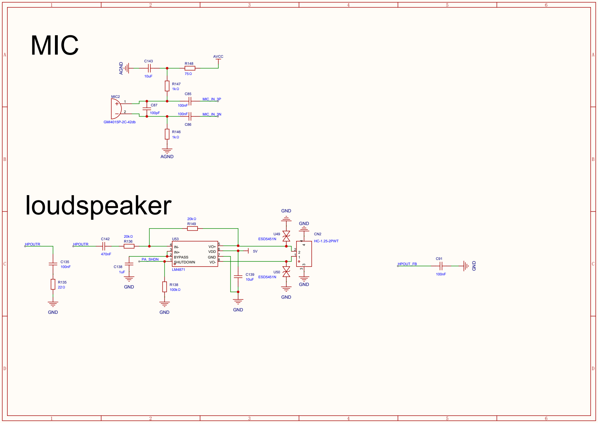

*Final page 5. [Vector PDF](../schematic/AuraBar-Schematic-v1.0.pdf#page=5). / 最终第 5 页。*

Use an 8 Ω speaker consistent with the intended design. Output power, frequency response and perceived loudness depend on supply, distortion limit, speaker and enclosure. Playback confirmation does not establish those specifications. Microphone capture, echo cancellation and wake-word performance require separate tests.

使用与设计匹配的 8 Ω 扬声器。输出功率、频响与实际响度取决于供电、失真限值、扬声器和腔体；播放成功不能证明这些指标。麦克风采集、回声消除与唤醒词性能需要另行测试。

## 10. Wireless Connectivity / 无线连接

RTL8723DS U11 provides a Wi-Fi SDIO path and a Bluetooth UART path. The module is not a standalone ready-to-use networking service: BSP support, module firmware, antenna integration and application software determine the usable features. Current computer-companion acceptance uses USB10.

RTL8723DS U11 提供 Wi-Fi SDIO 与蓝牙 UART 路径。模块本身不是可直接交付的完整网络服务，实际功能取决于 BSP、模块固件、天线集成与应用软件；当前电脑伴侣的验收链路使用 USB10。

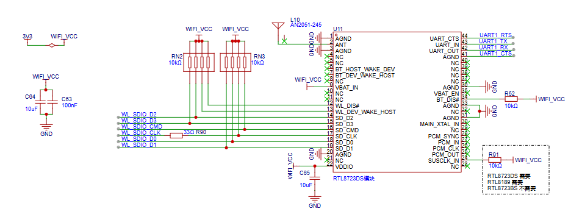

*Original Word image 22. / Word 原图 22。*

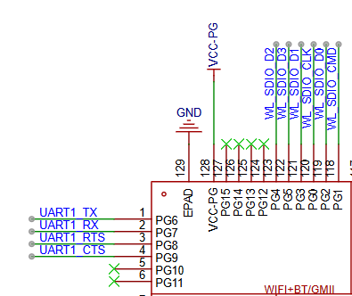

*Original Word image 23. / Word 原图 23。*

| Function / 功能 | Controller / 主控 | Design consideration / 设计关注点 |
|---|---|---|
| SDIO clock / 时钟 | PG0 / SDC1_CLK | R90 = 33 Ω series termination; verify edges / 串联阻尼并验证边沿 |
| SDIO command / 命令 | PG1 / SDC1_CMD | Pull state and driver setup / 上拉状态与驱动配置 |
| SDIO data / 数据 | PG2–PG5 / D0–D3 | Pin mux, signal integrity and bus initialization / 复用、信号完整性与初始化 |
| Bluetooth UART / 蓝牙串口 | PG6–PG9 / UART1 | TX/RX plus RTS/CTS; verify endpoint directions / 含流控，按端点核对方向 |
| Antenna / 天线 | AN2051-245, L10 | Clearance, matching and enclosure effects / 净空、匹配与外壳影响 |

The original module circuit pulls enable and several unused control inputs to defined states and leaves PCM and selected wake/clock paths unused. These choices limit what sleep/wake or Bluetooth-audio behavior can be assumed. Software must be configured to the actual wiring; do not promise host wake or PCM routing merely because the silicon supports it.

原模块电路将使能及部分未用控制输入固定到确定状态，未使用 PCM 与部分唤醒/时钟路径。这限制了能够直接假设的休眠、唤醒与蓝牙音频行为。软件须匹配实际接线，不能只因芯片支持就宣称板卡具有主机唤醒或 PCM 路由。

### Optional U5 socket / 可选 U5 插座

U5 is an MX-02 socket on UART0. The final NET sheet labels its mode input as normal versus low-power/transmit-only behavior. This is a module-specific annotation, not a universal BLE Mesh mode definition. Check the installed module and its firmware before using those controls. A BOM entry does not prove the module is populated or Mesh software is implemented.

U5 是 UART0 上的 MX-02 插座。最终 NET 图页将其模式输入注释为正常与低功耗/仅发送行为；这是特定模块说明，不是通用 BLE Mesh 模式定义。使用前应核对实际模块及固件；BOM 条目不能证明模块已装配或 Mesh 软件已实现。

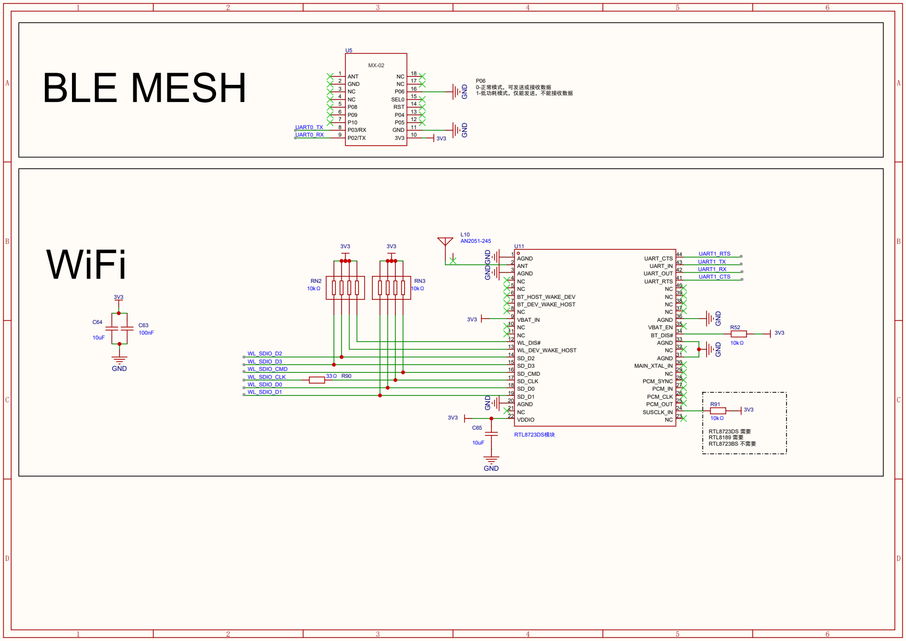

*Final page 2: RTL8723DS and optional socket. [Vector PDF](../schematic/AuraBar-Schematic-v1.0.pdf#page=2). / 最终第 2 页：无线模块与可选插座。*

## 11. Display Touch and Backlight / 显示触摸与背光

### 11.1 Display connector / 显示连接器

The current panel is a 6.9-inch bar display. FPC2 is a 30-contact, 0.5 mm connector carrying four MIPI data pairs, a differential clock, TE, reset, 3.3 V and the backlight connections. C132 = 22 µF and C133 = 1 µF provide local supply capacitance. A connector with the same pitch and contact count is not automatically pin-compatible.

当前面板为 6.9 英寸长条屏。FPC2 为 30 触点、0.5 mm 连接器，承载四组 MIPI 数据差分对、差分时钟、TE、复位、3.3 V 与背光连接；C132 = 22 µF、C133 = 1 µF 提供本地电容。间距和触点数相同不代表连接器或屏幕线序兼容。

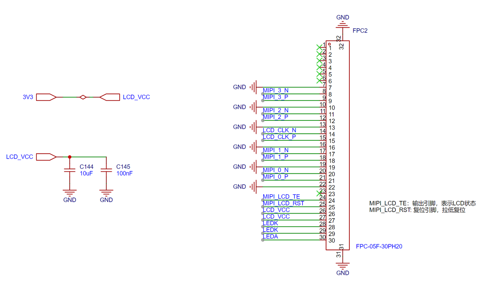

*Original Word image 24. Unused and grounded contacts must be read individually; do not assume every early contact is ground. / Word 原图 24；未用与接地触点应逐一查看，不能笼统认为前几个触点都接地。*

### 11.2 Framebuffer and visible coordinates / 帧缓冲与可见坐标

The original panel description uses 280 × 1424, while current board records show driver `fl7707n_mipi`, framebuffer 720 × 1424, 32 bpp, 2880-byte stride and virtual height 2848. The application-visible landscape area is 1424 × 280. Driver timing, framebuffer allocation, orientation and the visible UI region are different layers; changing a 720 entry to 280 is not a valid general repair.

原屏幕说明使用 280 × 1424，而当前板卡记录为 `fl7707n_mipi` 驱动、720 × 1424 帧缓冲、32 bpp、2880 字节行跨度、虚拟高度 2848；应用可见横向区域为 1424 × 280。驱动时序、缓冲分配、方向与可见界面是不同层次，不能把某处 720 直接改成 280 当作通用修复。

Check a known color pattern first, then buffer stride and pixel format, then rotation/cropping and LVGL flush boundaries. Separately test touch alignment and backlight. A framebuffer capture validates stored pixels, while the physical panel validates the complete output chain.

先验证固定色块，再检查行跨度、像素格式、旋转/裁剪与 LVGL 刷新边界；触摸与背光单独验证。帧缓冲截图证明内存像素内容，实物屏幕才能验证完整输出链路。

### 11.3 Touch connector and coordinate mapping / 触摸线序与坐标映射

FPC7 is a 6-contact touch connector with additional ground/mounting pads. The **final netlist**, rather than the old prose, gives this contact mapping:

FPC7 为六触点触摸连接器，另有接地/固定焊盘。以下线序依据**最终网表**，修正旧文字的顺序：

| FPC7 contact / 触点 | Net / 网络 | T113-S3 connection / 主控连接 |
|---|---|---|
| 1 | GND | Ground / 地 |
| 2 | TP_INT | PE5, pin 42 / 42 脚 |
| 3 | TP_SDA | PE1, pin 45 / 45 脚 |
| 4 | TP_SCL | PE0, pin 44 / 44 脚 |
| 5 | TP_RST | PE4, pin 43 / 43 脚 |
| 6 | 3V3 | Supply / 电源 |
| 7 / 8 | GND | Additional pads / 附加焊盘 |

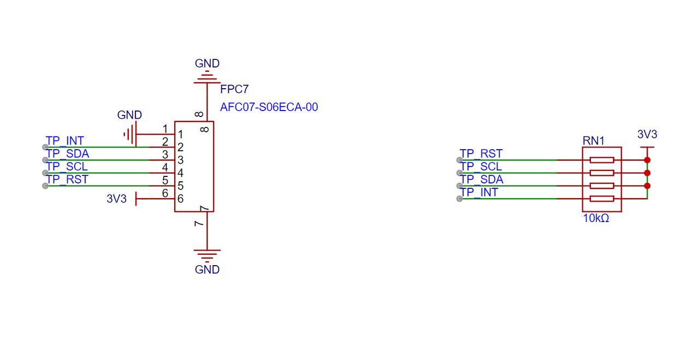

*Additional circuit image; confirm final connector numbering and contact orientation before wiring. / 补充电路图，接线前确认最终脚号与触点朝向。*

RN1 is a 10 kΩ resistor array. I²C pull-up selection depends on bus capacitance, speed and voltage; INT/RST behavior is controller-specific and should not be generalized as identical to I²C open-drain signaling. Check reset/address selection, interrupt configuration and edge/corner coordinate mapping in the running BSP.

RN1 为 10 kΩ 排阻。I²C 上拉选择取决于总线电容、速率与电压；INT/RST 的行为由触摸控制器决定，不能笼统等同于 I²C 开漏信号。应核查运行 BSP 的复位/地址选择、中断配置以及四角与边缘坐标映射。

### 11.4 Backlight regulation / 背光调节

The backlight driver is **MT9201 U52**. The original notes describe two strings of four LEDs, a nominal 12 V forward requirement and a reduced-current target around 20 mA. These are source design assumptions, not a measured lifetime or brightness specification. Confirm the actual panel string topology and whether a quoted current is per string or total.

背光驱动为 **MT9201 U52**。原说明描述两串、每串四颗 LED，标称正向需求约 12 V，并以约 20 mA 作为较低电流设计目标。这些属于原始设计假设，不是实测寿命或亮度指标。需核对实际屏幕串并联结构，以及所述电流是单串还是总电流。

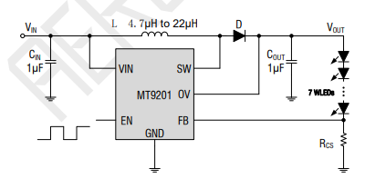

*Original Word image 25: reference boost topology. / Word 原图 25：升压拓扑参考。*

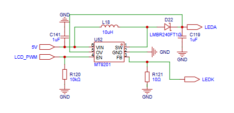

*Original Word image 26. / Word 原图 26。*

| Element / 元件 | Value / 参数 | Purpose / 用途 |
|---|---|---|
| L18 | 10 µH, WPN201610H100MT | Boost inductor / 升压电感 |
| D22 | LMBR240FT1G | Boost rectifier to LEDA / 至 LEDA 的升压整流 |
| R121 | 10 Ω | Feedback current sensing / 反馈电流采样 |
| R120 | 10 kΩ | EN pull-down / EN 下拉 |
| C141 / C119 | 1 µF each; BOM lists 50 V X5R parts / BOM 为 50 V X5R | Input/output capacitance / 输入输出电容 |
| FPC2 30 / 28–29 | LEDA / LEDK | Backlight anode/cathode / 背光阳极与阴极 |

For a current-sense driver, `I ≈ VFB/Rsense`; the 10 Ω resistor alone does not prove the LED current without the driver's feedback reference. Check inductor peak current, diode voltage/current margin and output-capacitor effective capacitance under bias. The source recommends low-ESR/X7R selection, whereas the actual BOM lists X5R; evaluate the installed part rather than silently replacing that distinction in the documentation.

对电流采样驱动，`I ≈ VFB/Rsense`；缺少驱动反馈基准时，不能只凭 10 Ω 就确认 LED 电流。应检查电感峰值电流、二极管电压/电流裕量，以及输出电容带偏压后的有效容量。原说明建议低 ESR/X7R，而实际 BOM 为 X5R，应按实际器件评估并保留这个差异。

R120 pulls EN low before active drive, reducing unintended startup lighting. This expresses a hardware default; test the real power sequence and PWM behavior. Open-load boost voltage and protection behavior must be checked before powering without a panel; component voltage ratings must cover the actual worst case.

R120 在主动驱动前将 EN 下拉，降低上电误亮的可能；这只是硬件默认状态，仍需测试实际时序与 PWM。无负载升压及保护行为应在无屏上电前核对，器件耐压必须覆盖真实最坏情况。

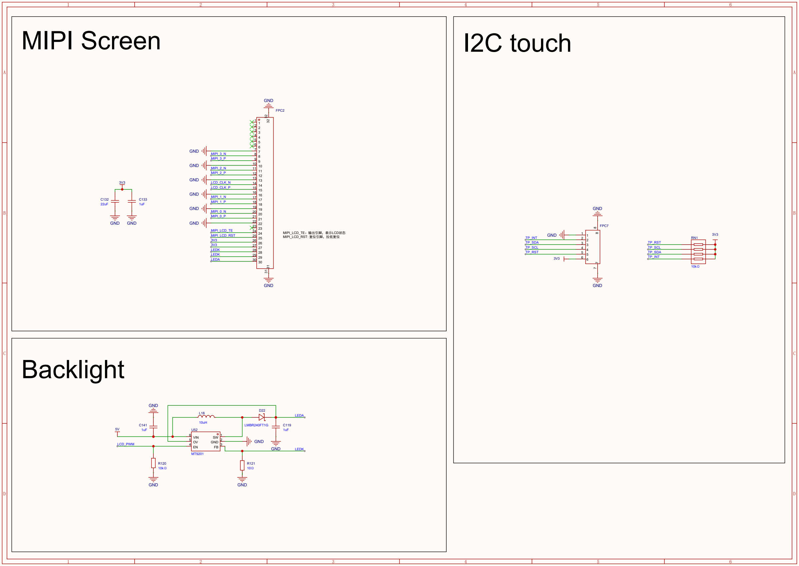

*Final page 7: MIPI connector, I²C touch and backlight. [Vector PDF](../schematic/AuraBar-Schematic-v1.0.pdf#page=7). / 最终第 7 页：显示端子、触摸与背光。*

## 12. PCB and Bring-up Review / PCB 与调试审查

The supplied STEP gives an approximately 75 × 38 mm board body. It is useful for geometry inspection, but it does not establish enclosure clearance, panel fixation or connector accessibility. New product renders can explore new enclosures; mechanical release needs an actual assembly baseline.

提供的 STEP 对应约 75 × 38 mm 板体，可用于几何检查，但不能证明外壳间隙、屏幕固定或连接器插拔空间。产品渲染可探索新外壳，正式结构发布仍需实际装配基线。

| Review area / 审查项 | Engineering work / 工程工作 | Evidence to retain / 应保留依据 |
|---|---|---|
| Supply loops / 电源回路 | Trace switching current and feedback return / 核查开关电流与反馈回流 | Layout, startup/ripple/thermal captures / 布局、启动、纹波与温升记录 |
| MIPI and USB / 高速接口 | Inspect pairs, reference planes and connector transitions / 检查差分对、参考面与过渡 | Stack-up, routing review, sustained link tests / 层叠、布线审查与持续链路测试 |
| Clock/reset / 时钟复位 | Check placement and power sequencing / 检查布局与上电时序 | Waveforms and repeated-start results / 波形与重复启动结果 |
| Audio / 音频 | Check bias, gain, clipping and switching noise / 检查偏置、增益、削顶与开关噪声 | Capture/playback measurements and listening records / 采放测量与听音记录 |
| Antenna / 天线 | Inspect clearance and enclosure interaction / 检查净空与结构影响 | Installed wireless tests / 整机无线测试 |
| FPC/mechanics / 排线结构 | Check contact orientation, bend and strain / 检查触点朝向、弯折与应力 | Assembly drawings and physical fit / 装配图与试装 |

Recommended sequence: unpowered inspection → controlled 5 V power and rail measurement → reset/clock and boot logs → Flash recovery → fixed display pattern → touch boundaries → test audio → USB events → sustained use in the target enclosure. Record the exact board, image and application revision. Existing functional records are linked from [validation](../../docs/testing/README.md); they do not replace electrical qualification.

建议顺序为：断电检查 → 受控 5 V 供电及电源测量 → 复位/时钟与启动日志 → Flash 恢复 → 固定显示图案 → 触摸边界 → 测试音频 → USB 事件 → 目标外壳中的持续运行。记录准确的板卡、系统与应用版本。已有功能记录见[验证说明](../../docs/testing/README.md)，不替代电气验收。

One netlist item merits a separate electrical review: T1 HPOUTL pin 99 is on GND in the exported source. Confirm the intended codec output mode, actual assembly and device requirements before enabling that channel. Working right-channel playback does not resolve this unused-channel connection question.

网表中有一项需要独立电气审查：导出资料将 T1 的 HPOUTL、99 脚接至 GND。启用该声道前，应核查 codec 输出模式、实际装配与器件要求；右声道播放正常不能证明未用声道的接法已经验证。

## 13. Source Corrections / 来源差异与修正

This register makes interpretation changes explicit. Source files and embedded images remain preserved; documentation corrections do not modify the physical board or silently change the original BOM.

本表明确记录解释上的修正。原始文件和图片保持保留，文档修正不改变实物板卡，也不擅自修改原 BOM。

| Earlier note / 早期说法 | Reconciled interpretation / 核对后的解释 |
|---|---|
| 3.3 V divider R2 = 68 kΩ | BOM/netlist: R2 = 680 kΩ upper, R1 = 150 kΩ lower; nominal 3.32 V / 按实际连接计算 |
| Multiple divider roles reversed / 多路分压角色颠倒 | Follow section 4 table derived from FB connections / 按第 4 节 FB 连接表 |
| Main clock C30/C31 | Final C122/C123; C30 is a decoupling capacitor / 最终位号不同 |
| 10 MΩ resistor trims RTC frequency / 10 MΩ 微调频率 | Feedback/bias path; loading determines frequency / 反馈偏置，频率与负载有关 |
| FEL key called SW2 | Final SW1 = Flash/FEL, SW2 = reset / 按最终按键位号 |
| /WP always forces read-only / WP 一定使只读 | Protection depends on register/mode configuration / 与寄存器及模式有关 |
| Rd implies PD / 下拉代表 PD | Rd indicates sink attachment; no PD controller demonstrated / 仅表示取电端连接 |
| D22/D23 are both USB isolation diodes / 都是 USB 隔离 | D23 is VIN5V → 5V; D22 is backlight boost / 分属两条电路 |
| Image named power-oring-diode / 文件名含隔离二极管 | Image content is LED3/R115 indicator / 内容实际为指示灯 |
| Microphone C46/C47, R27/R34 | Reference identifiers; final C85/C86 and R146/R147 / 最终位号不同 |
| 100 nF at 1 kHz ≈ 1.6 Ω | Correct magnitude ≈ 1.59 kΩ / 正确数量级为千欧 |
| 100 pF is a short at 10 MHz / 理想短路 | Reactance ≈ 159 Ω; attenuation depends on circuit / 衰减取决于电路 |
| Final amplifier screenshot is LM4871 / 功放截图为最终版 | Word figure still shows LM4890S; final PDF uses U53 LM4871 / 截图与最终图页不同 |
| R144 = 68 kΩ feedback | Final R149 = 20 kΩ; gain must use final topology / 增益按最终网络计算 |
| Series RC shunt is a conventional low-pass / RC 旁路为常规低通 | Frequency-dependent load; codec source impedance matters / 是与源阻抗有关的负载支路 |
| Touch pin 1 = INT, PB group / 触摸首脚与端口 | Final pin 1 = GND, pin 2 = INT; controller PE group / 以网表为准 |
| UART3 = PB8/PB9 | Final UART3 TX/RX = PB6/PB7, T1 pins 80/79 / 最终管脚按网表修正 |
| SPI0 uses PF; MIPI uses PD13–19 / 接口端口误记 | Final SPI0 uses PC2–PC7; MIPI pairs use PD0–PD9 / 最终端口不同 |
| All first seven LCD contacts are ground / LCD 前七脚均接地 | Inspect individual contacts; several are unused / 逐脚核对，部分未用 |
| All backlight capacitors are X7R / 均为 X7R | Final C119/C141 BOM lists 50 V X5R / 最终 BOM 为 X5R |
| 50 populated BOM lines / BOM 50 项 | CSV contains 49 non-empty component rows and a blank trailing row / 49 条非空物料行 |
| 0 Ω gives analog isolation / 0 Ω 模拟隔离 | Conductive connection, not galvanic isolation / 导通连接而非电气隔离 |

## 14. Components and Source Documents / 器件与设计资料

| Function / 功能 | Final part / 最终器件 | Designator / 位号 | Supplier code / 采购编码 |
|---|---|---|---|
| SoC / 主控 | T113-S3 | T1 | See BOM / 见 BOM |
| Regulators / 稳压器 | SY8088AAC ×4 | U1–U4 | C79313 |
| Flash / 闪存 | W25N01GVZEIG | U6 | C907680 |
| Wireless / 无线 | RTL8723DS module | U11 | C2920724 |
| Optional socket / 可选插座 | MX02 | U5 | See BOM / 见 BOM |
| Amplifier / 功放 | LM4871 | U53 | C7494970 |
| Microphone / 麦克风 | GMI4015P-2C-42db | MIC2 | C233292 |
| Backlight / 背光 | MT9201 | U52 | C182966 |
| USB-C | KH-TYPE-C-16P ×2 | USB9/USB10 | C709357 |
| LCD connector / 屏幕端子 | FPC-05F-30PH20 | FPC2 | C2856808 |
| Touch connector / 触摸端子 | AFC07-S06ECA-00 | FPC7 | C262579 |
| UART header / 串口端子 | ZX-MX1.25-3PWT | U24 | C7430469 |
| Speaker connector / 扬声器端子 | HC-1.25-2PWT | CN2 | C2845379 |
| Main crystal / 主晶体 | XL2EL89COI-111YLC-24M | X1 | C5444545 |
| RTC crystal / RTC 晶体 | X321532768KGD2SI | X2 | C620155 |
| Antenna / 天线 | AN2051-245 | L10 | C99727 |
| Schottky diodes / 肖特基 | LMBR240FT1G | D22/D23 | C383230 |
| ESD protection / 静电保护 | ESD5451N ×11 | See BOM / 见 BOM | C2936977 |

- [Editable LCEDA project / 可编辑工程](../lceda/6.22_Screen.eprj2)
- [Final schematic PDF / 最终原理图](../schematic/AuraBar-Schematic-v1.0.pdf)
- [BOM spreadsheet / BOM 表格](../bom/AuraBar-BOM-v1.0.xlsx) and [CSV](../bom/AuraBar-BOM-v1.0.csv)
- [Netlist / 网表](../schematic/netlist.net) and [DXF sheets / DXF 图页](../schematic/dxf/)
- [Figure index / 图像索引](figure-index.md) and [machine-readable provenance / 来源清单](figure-provenance.json)
- [Interface map / 接口表](../../docs/hardware/interfaces.md) and [mechanical references / 机械参考](../mechanical/README.md)
- [Hardware license / 硬件许可](../LICENSE) and [third-party notices / 第三方说明](../../THIRD_PARTY_NOTICES.md)

The supplied controller reference is [T113-S3 datasheet v1.6](https://linux-sunxi.org/images/7/73/T113-s3_datasheet_v1.6.pdf), hosted by the community. Obtain current manufacturer documentation and procurement-specific datasheets for design sign-off. No EMI, thermal, lifetime, automotive or production qualification is inferred from the presence of a circuit or reference image.

原说明提供的主控参考为社区托管的 [T113-S3 v1.6 数据手册](https://linux-sunxi.org/images/7/73/T113-s3_datasheet_v1.6.pdf)。设计签核需补齐原厂资料与具体采购器件手册。不能因电路或参考图存在，就推定已完成 EMI、温升、寿命、车规或量产验收。
